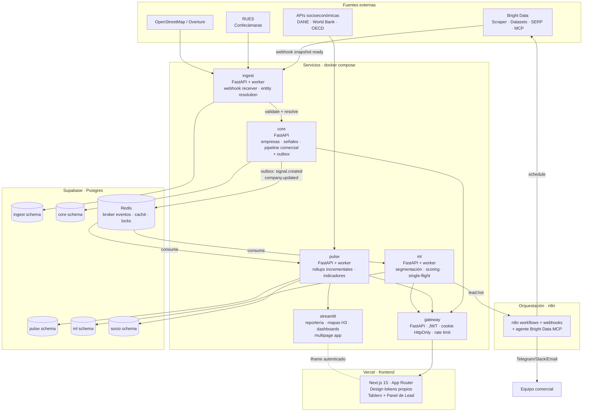

# ADR-IMT-0001-ARCH — Arquitectura mid+ de Invent-Market-Tracker

| Field | Value |
|---|---|
| ADR | ADR-IMT-0001-ARCH |
| Version | 2.3 |
| Layer / run | L1 / Round 1: Backend base: ingestion, data, services, events, security, CI/CD, base reporting |
| Status | accepted (promoted), decided 2026-10-18 |
| Authority | Source of truth for implementation (see `AGENTS.md`). On conflict, the higher-numbered amendment wins over the base text |
| Language | Spanish. All other repository documentation is English |
| Origin | Exported from the project vault on 2026-10-18. Do not edit here; see `docs/README.md` |


> **Versión vigente: 2.3** (Enmienda 2 aplicada 2026-10-18; Enmienda 1 aplicada 2026-10-17). **Regla de precedencia: ante cualquier conflicto entre el cuerpo base y una enmienda, gana la enmienda de mayor número (E2 > E1 > base).** La base del documento sigue siendo v2.1; la **Enmienda 1 (§E1 al final)** define las funcionalidades de usuario y revisa topología, caché del Brief, outbox+inbox y pipeline. Las secciones de la base afectadas llevan la nota «**Ver §E1.N**».

> **Estado:** `accepted` (2026-10-18) — rev. 2026-10-17. Reemplaza a la v1: la v1 era un diseño de pipeline único; la v2 lo separa en servicios con base propia, patrón outbox, gateway único y una UX con design tokens que replica el idioma "sidebar oscuro + tablero + panel de atención". Nada construido todavía.

## 0. Resumen ejecutivo

**Qué es:** un **ERP + Project Analytics Platform (PAP)** interno de la agencia, no un CRM. Dos planos acoplados por eventos:

- **Plano de inteligencia (PAP):** descubrir empresas, detectar señales de compra, segmentar y priorizar; alimentar la formulación de proyectos SaaS/AaaS/consultoría y la curación de leads para gastronomía, eventos y marketing digital.
- **Plano operacional (ERP-lite):** gestionar los leads curados, el pipeline comercial, los proyectos derivados, los briefs comerciales y la trazabilidad de outcomes que entrenan los modelos.

**Qué cambia respecto a la v1:**

| Tema | v1 (pipeline) | v2 (mid+) |
| --- | --- | --- |
| Topología | Un contenedor n8n + un backend monolítico + dashboard | **7 servicios + streamlit** (gateway, identity, ingest, core, pulse, brief, ml; ver §E2.2) con base propia y comunicación por eventos |
| Datos | Supabase con esquemas medallion compartidos | **1 proyecto Supabase · 7 schemas · 14 roles** (owner + app por schema; ver §E2.1) |
| Eventos | Implícitos (n8n encola) | **Patrón outbox**: cambio y evento en la misma transacción + relay a Redis Streams |
| ML | Batch nocturno | **Single-flight** por `company_id`; stale-while-revalidate del score |
| Frontend | Next.js genérico | **Next.js 15** para la app ERP (lead inbox, pipeline, proyectos) + **Streamlit** para toda la reportería y visualización de datos; design tokens compartidos |
| CI/CD | Compose local | **Pipeline de 10 etapas** con migraciones expand, smoke sobre URLs reales y rollback automático por tag |
| Backups | Dump nocturno | Nocturno **con restore verificado en cada corrida** y cifrado con `age` |
| Zonas | Genérica | **Colombia-first** (RUES como eje, Ley 1581/2012) |

**Alcance mínimo del MVP (fases F0–F2):** gateway + ingest (Google Maps + Computrabajo) + core con outbox + analytics con rollups + lead inbox en Next.js. Resto a partir de F3.

---

## 1. Objetivo y nichos

### 1.1 Para qué existe

Herramienta interna que ayuda a la agencia a:

1. **Formular proyectos** SaaS/AaaS y consultoría a partir de evidencia de mercado, no de intuición.
2. **Identificar leads calificados** por línea de servicio.
3. **Curar y segmentar** la base de prospección para campañas de catering, eventos y marketing digital.
4. **Gestionar operativamente** el pipeline comercial, los proyectos derivados y los outcomes que retroalimentan el modelo.

### 1.2 Nichos y líneas de servicio

Dos grandes nichos, cinco líneas:

| Nicho | Línea | ICP Colombia | Señales |
|---|---|---|---|
| **Software** | SaaS | PyMEs 20–200 (retail, salud, logística, inmobiliaria, educación, legal) | Vacantes operativas repetitivas, formularios como "sistema", sin app |
| | AaaS | 50–500 (call centers, cobranzas, e-commerce, turismo) | Vacantes de SAC en volumen, reseñas "nunca contestan" |
| | Consultoría SW | 100–1000 (manufactura, financiero) | Nuevo CTO/CIO, nota de prensa, vacantes "transformación digital" |
| | Analítica + BD | 50–500 (retail multisucursal, fintech, salud) | Vacantes de "analista de datos", migraciones ERP, mención "Power BI" |
| **Social events & media** | Marketing digital + community | PyMEs HORECA, moda, bienestar | Rating alto en Maps + bajo seguidores IG + web ausente |
| | Catering + eventos | Corporativos 100+, hoteles, universidades | Aniversarios, "evento" en IG, aperturas HORECA, hoteles con salón |

**Ciudades piloto:** Medellín (F0–F2) → Bogotá (F3) → Cali, Barranquilla, Cartagena (F4+).

### 1.3 Definición operativa de "casi tiempo real"

**No es streaming.** Bright Data opera por *snapshots* asíncronos; la latencia la gobierna la frecuencia de los triggers:

| Señal | Frecuencia | Latencia extremo-a-extremo objetivo |
|---|---|---|
| Aperturas Google Maps | diaria | ≤ 24 h |
| Vacantes (Computrabajo, Elempleo, LinkedIn Jobs) | cada 6–12 h | ≤ 12 h |
| Reseñas HORECA | diaria | ≤ 24 h |
| Perfiles LinkedIn empresas | semanal | ≤ 7 d |
| Lead "hot" detectado → alerta en Telegram | **evento** (no cron) | **≤ 60 s desde el commit en core** |

El último es la métrica mid+ del sistema: una señal entra, atraviesa 3 servicios, dispara un score, y notifica — sin cron intermedios. Lo habilita el patrón outbox (§7).

---

## 2. Vista general



**Principio rector:** **n8n orquesta, Postgres guarda la verdad, los servicios Python razonan.** Ninguna lógica de negocio vive en nodos de n8n más allá de orquestación y notificación — así todo es versionable y testeable.

---

## 3. Principios arquitectónicos mid+

Siete reglas que gobiernan toda decisión de diseño. Si una propuesta las viola, se corrige o se rechaza.

| # | Principio | Qué significa en la práctica |
|---|---|---|
| **P1** | **Un servicio, una base** | Cada servicio es dueño exclusivo de su schema. Nadie lee la base de otro: se piden datos por API o se consumen eventos |
| **P2** | **Signal-first, source-second** | Antes de abrir una fuente, se define el ICP y la señal que resuelve. Las fuentes se eliminan, no se acumulan |
| **P3** | **RUES como eje de verdad** | Toda empresa que llega por LinkedIn, Maps o IG se hace match contra RUES. Sin match en 2 intentos → cuarentena. Elimina el 60% del ruido |
| **P4** | **Outbox obligatorio** | Todo cambio relevante en core escribe su evento en la misma transacción. Sin outbox, un fallo entre guardar y publicar deja un score viejo para siempre |
| **P5** | **Degradación por tarjeta** | Si cae `ml`, el tablero sigue mostrando datos de analytics sin score. Una dependencia caída apaga una tarjeta, no la página |
| **P6** | **Frescura visible** | `as_of`, `stale`, `degraded` y `score_version` se muestran siempre que existan. Ocultar una degradación es mentir |
| **P7** | **Outcomes desde el día 1** | `core.lead_outcome` captura cada contacto, respuesta, reunión y cierre. Sin esto, el ML supervisado nunca llega. Es *infraestructura*, no feature |

---

## 4. Ingesta — Bright Data + n8n + agente MCP

### 4.1 Capa 1: workflows n8n (batch programado)

Para lo repetitivo y predecible. Un workflow por fuente/dataset, versionado como JSON en `/orchestration/n8n/`.

| Workflow | Fuente | Trigger | Delivery |
|---|---|---|---|
| `wf_maps_medellin` | Bright Data Scraper Google Maps | diario 06:00 COT | webhook → `POST /ingest/webhook/bd` |
| `wf_computrabajo_tech` | Scraper custom + SERP | cada 12 h | mismo webhook |
| `wf_linkedin_companies_backfill` | Dataset LinkedIn Companies | mensual | S3 → `ingest.loader` |
| `wf_linkedin_jobs` | Dataset LinkedIn Jobs CO | semanal | webhook |
| `wf_instagram_horeca` | Scraper IG Business | semanal | webhook |
| `wf_rues_delta` | HTTP contra confecamaras.co | semanal | webhook |
| `wf_socioeco_refresh` | DANE API | mensual | webhook → `analytics` |
| `wf_hot_lead_alert` | Supabase Realtime sobre `ml.lead_score` | **evento** | Telegram/Slack |
| `wf_ops_health` | Dashboard interno | horario | Email si rojo |

**Patrón recomendado (trigger + webhook, no polling):**

```
[n8n Schedule] → POST /datasets/v3/trigger (dataset_id, inputs, notify=https://ingest/webhook/bd)
      ↓ (Bright Data procesa de forma asíncrona)
[ingest.webhook] ← snapshot ready → GET snapshot content
      → INSERT ingest.raw_snapshot (snapshot_id, dataset_id, payload JSONB, fetched_at, sha256)
      → enqueue ingest.processor job (vía Redis)
```

### 4.2 Capa 2: agente Bright Data MCP (exploración y enriquecimiento JIT)

Para lo exploratorio y dirigido. Un agente MCP corre dentro del servicio `ingest`, con acceso a Bright Data MCP (60+ tools: search, scrape, structured extraction, browser automation). Casos de uso:

1. **Enriquecimiento JIT:** cuando entra una empresa nueva por Maps, el agente va a su web (si tiene) y extrae stack, formularios, catálogo, teléfonos de contacto empresarial.
2. **Investigación dirigida:** el analista escribe "busca restaurantes nuevos en Chapinero con delivery propio pero sin app" → el agente encadena SERP → Scraper → extracción.
3. **Verificación de competencia:** monitoreo semanal de competidores directos de la agencia.

Separación clara: n8n = *cron*, agente = *consulta*. Nunca el agente para lo que un workflow ya hace.

### 4.3 Idempotencia, costo y control

- **Hash de contenido:** `sha256(payload normalizado)`; `UNIQUE(source, external_id, sha256)` — solo los *cambios* generan señales nuevas.
- **Presupuesto por fuente:** tabla `ingest.budget(source, period, max_records, consumed)`; n8n consulta antes de disparar.
- **Rotación de API keys:** una key de Bright Data por entorno (dev, staging, prod).
- **Fallback:** si Bright Data responde error, el workflow guarda el intento en `ingest.failed_fetch` y reintenta con backoff exponencial; después de 5 fallos, va a dead-letter.

### 4.4 Fuentes Colombia

| Fuente | Vía | Granularidad | Prioridad |
|---|---|---|---|
| Google Maps | BD Scraper | Negocio | **F1** |
| Computrabajo | Scraper custom (allowlist) | Vacante | **F1** |
| LinkedIn Companies | BD Dataset | Empresa + país + industria | F2 |
| LinkedIn Jobs | BD Dataset filtrado CO | Vacante | F2 |
| Instagram Business | BD Scraper | Perfil | F2 |
| RUES | HTTP a confecamaras.co | Empresa (NIT) | **F1 — eje de verdad** |
| DANE | API SDMX | Municipio/comuna | F4 |
| World Bank + OECD | `wbgapi`, `sdmx1` | País | F4 |
| OSM / Overture | `osmnx`, `overturemaps` | Punto → H3 | F4 |
| Elempleo.com | SERP + scraper | Vacante | F3 |
| TripAdvisor | BD Scraper | Negocio | F4 |

**Fuentes explícitamente evitadas al inicio:** Twitter/X, TikTok, Crunchbase (poca cobertura CO), scraping de WhatsApp Business.

---

## 5. Almacenamiento — Supabase

### 5.1 Un proyecto, siete schemas, catorce roles

> **Reemplazado por §E2.1.** El mapa canónico de schemas y roles está en §E2.1 (7 schemas · 14 roles). La versión v2.0 de esta sección listaba 5 schemas y 10 roles con `analytics` y sin `identity`, `pulse` ni `brief`.

En Mid+ cada schema tiene **un servicio dueño** y dos roles: un `owner` (migraciones, seed, backups) y un `app` (lectura/escritura de tablas). La regla "ningún servicio lee la base de otro" se cumple **por permisos de Postgres**, no por convención.

**Extensiones:** `pgvector` (embeddings), `PostGIS` (consultas H3), `pg_cron` (mantenimiento), `pg_trgm` (match difuso de nombres).

### 5.2 Modelo semántico (el "modelo estrella" tipo Power BI)

Vive en `analytics` como vistas materializadas construidas por dbt desde `core` y `socio`:

- **Dimensiones:** `dim_company`, `dim_location`, `dim_sector` (CIIU + taxonomía propia), `dim_service_line`, `dim_source`, `dim_date`, `dim_territory`.
- **Hechos:** `fact_signal`, `fact_company_snapshot`, `fact_lead_outcome`, `fact_lead_score` (snapshot diario), `fact_territory_indicator`.
- **Medidas (equivalente DAX):** `MetricFlow` o `Cube` las define una vez en YAML; el dashboard y las APIs consultan la misma métrica.

### 5.3 Resolución de entidades (la pieza más subestimada)

Sin esto las métricas se inflan al triple. **Flujo:**

```
ingest.raw_snapshot (fila nueva)
    ↓
ingest.entity_candidate (nombre + ciudad + NIT candidato + fuzzy hash)
    ↓
Splink (bloqueo por ciudad + similitud nombre + similitud dirección)
    ↓
¿match contra RUES por NIT?
    ├─ Sí (score > 0.9) → core.company (existente) + append source_flag
    ├─ Borderline (0.6–0.9) → ingest.entity_match_log (revisión manual)
    └─ No → core.company nuevo + ingest.rues_lookup_queue
```

**RUES es el eje:** cualquier empresa sin match en 2 intentos va a cuarentena (`ingest.quarantine`) y no cuenta como lead hasta resolverse.

### 5.4 Seguridad de la base

- **RLS activa** en `core.company`, `core.lead`, `core.project` por `tenant_id` (futuro multi-usuario de la agencia).
- **La `service_role` key** solo en servicios backend, **nunca en el frontend**.
- **Data API desactivada** en el dashboard de Supabase: nada se expone fuera de los servicios autorizados.
- **Enforce SSL** activado; conexión con `sslmode=verify-full`.
- **Pooler en modo transacción** (puerto 6543) para la app; modo sesión (5432) solo para migraciones y backups.

### 5.5 Configuración del pooler (crítica)

El modo transacción pierde sentencias preparadas: configuración por driver obligatoria.

| Driver | Config |
|---|---|
| asyncpg (FastAPI) | `connect_args={"statement_cache_size": 0, "prepared_statement_cache_size": 0}` + `pool_size=4`, `pool_pre_ping=True`, `pool_timeout=5` |
| psycopg 3 (workers) | `connect_args={"prepare_threshold": None}` + `pool_size=2` |

Un test de integración (`test_db_pooler.py`) con PgBouncer configurado como Supavisor valida esto; 10 clientes concurrentes × 50 queries sin el error *prepared statement does not exist*.

---

## 6. Topología de servicios

> **Ver §E1.2** — la topología sube a **7 servicios + streamlit** al separar `identity` (Django) y `brief` (FastAPI con single-flight). `analytics` se renombra a `pulse`.

### 6.1 Siete servicios, un gateway público

> **Reemplazado por §E2.2.** El registry canónico de servicios (con schema y roles dueños) está en §E2.2. La topología v2.0 de esta sección (5 servicios) quedó obsoleta tras E1.2.

### 6.2 Rol y procesos de cada servicio

> **Reemplazado por §E2.2.**

### 6.3 Pattern "supervisor" para agrupar procesos

Un servicio con 3 procesos (API + worker + relay) se agrupa en **un solo contenedor** con un supervisor en Python puro (`libs/common/supervise.py`). Beneficios:

- Un hijo que muere → el supervisor termina a los demás y sale con código 1 → Docker reinicia el contenedor completo → **estado coherente garantizado**.
- Watchdog por archivo de latido (`/tmp/hb/<proc>`): si no se escribe en 90 s, el supervisor sale.
- Reduce el conteo de contenedores de 15 a 5 → encaja en un VPS pequeño ($10/mes).

```toml
# services/core/procs.toml
proc
name = "api"
cmd = ["gunicorn", "core.main:app", "-k", "uvicorn.workers.UvicornWorker", "-w", "1", "-b", "[::]:8000"]
probe = "http://127.0.0.1:8000/health"

proc
name = "worker"
cmd = ["python", "-m", "core.worker"]
heartbeat = "/tmp/hb/worker"

proc
name = "relay"
cmd = ["python", "-m", "core.outbox_relay"]
heartbeat = "/tmp/hb/relay"

proc
name = "beat"
cmd = ["celery", "-A", "core.beat", "beat"]
```

### 6.4 Confianza cero entre servicios

En la red privada de Docker todo se ve con todo. La seguridad real:

| Barrera | Mecanismo |
|---|---|
| Gateway no tiene credenciales de base | Variables de entorno del gateway no incluyen `DATABASE_URL` |
| Postgres exige usuario + password por servicio | `core_app`, `analytics_app`, etc. |
| Redis exige usuario ACL | Dos usuarios: `edge` (gateway, solo rate-limit keys) y `data` (streams, caché) |
| APIs internas exigen token de servicio | JWT firmado por core/ml para llamadas service-to-service |
| `/internal/*` no se enruta al exterior | Gateway devuelve 404 para cualquier path que no sea `/api/v1/*` |

---

## 7. Patrón outbox + eventos entre servicios

> **Ver §E1.4** — completa este apartado con el **inbox** (`processed_event` por consumidor, exactly-once effect) y el comando **republish** para reconstruir pulse/brief/ml desde el log.

### 7.1 Por qué outbox

Sin outbox, este escenario rompe la plataforma:

```
1. core guarda la señal en la tabla signal        ✓
2. core publica evento signal.created en Redis    ✗ (red cae)
3. core respondió 200 al cliente, pero ml nunca sabe
4. El lead score queda viejo para siempre
```

Con outbox:

```
1. core guarda la señal Y el evento en la MISMA transacción
2. Un relay separado lee outbox_event WHERE published_at IS NULL
3. Publica a Redis Streams con XADD
4. Marca published_at = NOW()
5. Si el relay cae, al reiniciar continúa donde quedó
```

### 7.2 Esquema

```sql
CREATE TABLE core.outbox_event (
    id              bigserial PRIMARY KEY,
    event_id        uuid NOT NULL DEFAULT gen_random_uuid(),
    aggregate_type  text NOT NULL,       -- 'company', 'lead', 'signal'
    aggregate_id    uuid NOT NULL,
    event_type      text NOT NULL,       -- 'company.updated', 'signal.created'
    version         bigint NOT NULL,     -- versión del agregado post-cambio
    payload         jsonb NOT NULL,
    created_at      timestamptz NOT NULL DEFAULT now(),
    published_at    timestamptz
);
CREATE INDEX ix_outbox_unpublished ON core.outbox_event (id) WHERE published_at IS NULL;
```

### 7.3 Eventos del dominio

| Evento | Publicado por | Consumido por | Qué dispara |
|---|---|---|---|
| `signal.created` | core | analytics, ml | Nueva vacante, apertura, reseña |
| `company.updated` | core | analytics, ml | Cambio en empleados, descripción, CTO |
| `lead.created` | core | ml, n8n | Nuevo lead calificado |
| `lead.outcome_recorded` | core | ml | Equipo registró "contactado/respondió/reunión/cerrado" |
| `lead.score_updated` | ml | n8n (via Supabase Realtime) | Nuevo score; si > umbral → alerta Telegram |
| `ingest.quarantine` | ingest | — (humano) | Empresa sin match en RUES tras 2 intentos |

### 7.4 Consumidores idempotentes

Cada consumidor mantiene `processed_event(event_id)` con PK sobre `event_id`. Si llega un evento ya procesado, lo ignora. **At-least-once delivery garantizado**; la deduplicación es responsabilidad del consumer.

### 7.5 Dead letter queue

Después de 5 reintentos con backoff exponencial (10s → 30s → 90s → 5min → 15min), el evento va a `core.outbox_dead_letter` con el error, y se dispara una alerta.

---

## 8. Transformación y modelo semántico

### 8.1 Herramientas

| Pieza | Elección | Rol |
|---|---|---|
| Transformación SQL | **dbt-core** sobre Postgres | `core` + `ingest` → vistas en `analytics` |
| Linaje y tests de calidad | dbt tests nativos + `elementary` | Fallo del test = alerta en n8n |
| Medidas semánticas | **MetricFlow** (dbt Semantic Layer) | "Equivalente DAX" en YAML versionado |
| Cómputo analítico in-process | **DuckDB** + **Polars** | Rollups rápidos sin castigar Postgres |
| Rollups incrementales | SQL + triggers de evento | `signal.created` → actualiza solo el día afectado |

### 8.2 Migraciones expand/contract

Toda migración es **compatible con el código en producción** (expand):
- añade tablas, índices, columnas NULL o con `server_default`
- nunca borra ni cambia tipos ni pone NOT NULL en algo existente

**Cambios destructivos** van en migración con prefijo `contract_` y solo después de que el código en producción haya dejado de usar la forma vieja. Un guardián en CI (`ops/check_migrations.py`) rechaza una migración destructiva mezclada con cambios de código.

---

## 9. Reportería y visualización — Streamlit multi-page

> **Ver §E1.5** — los endpoints del servicio `pulse` que Streamlit y el frontend Next.js consumen están catalogados ahí.

**Decisión fija (ARCH-0001 v2.1):** toda visualización de datos del proyecto se construye con **Streamlit**. Dashboards, mapas, informes de segmentos y vistas ad-hoc viven en un único servicio contenedorizado llamado `streamlit`, que consume `analytics` y `ml` a través del gateway. No se usa Vizro, Dash, Superset ni Power BI embebido. Las visualizaciones puntuales que lleven inline en la app Next.js (p. ej. mini-sparkline en el Lead Panel) se renderizan con Recharts, pero las páginas de reportería completas son siempre Streamlit.

### 9.1 Stack

- **Streamlit ≥ 1.40** con `st.navigation` + `/pages` (multi-page app oficial).
- **Plotly Express** y **Plotly Graph Objects** para gráficos interactivos con tema sincronizado.
- **pydeck** (via `st.pydeck_chart`) para mapas H3 y coropletas; **folium** vía `streamlit-folium` como alternativa cuando se necesite popups ricos.
- **streamlit-aggrid** para la tabla principal del lead inbox (filtros, selección múltiple, selección cruzada con el mapa).
- **DuckDB** + **Polars** como motor local: la app lee Parquet materializados por dbt desde un volumen compartido con `analytics`, y sólo golpea Postgres cuando necesita el delta del día.
- **Caché por consulta** con `@st.cache_data(ttl=…)`: 60 s para métricas vivas, 10 min para rollups diarios, 1 h para socioeconómicos.
- **`@st.cache_resource`** para el pool de Postgres y el cliente HTTP contra el gateway.
- **`st.session_state`** para los filtros globales (ciudad, línea de servicio, rango de fechas) — reemplaza el cross-filter nativo de Vizro con la ventaja de que el estado queda siempre explícito en código.
- **`st.query_params`** para persistir filtros en la URL y permitir compartir deep-links al equipo comercial.
- **Autenticación:** F2 usa auth básica delante en Caddy sobre una lista blanca del equipo; F5 pasa a JWT emitido por el gateway validado por `streamlit-authenticator` o un middleware propio.
- **Theming:** `.streamlit/config.toml` consume los mismos tokens que el frontend Next.js (azul mercado, cian analítica, violeta oportunidad, sidebar oscuro). Un script `scripts/sync_streamlit_theme.py` lee `frontend/src/styles/tokens.css` y regenera el `config.toml` en cada build; evita drift visual entre app y dashboard.
- **Evidence.dev** queda como opción paralela para reportes estáticos ejecutivos publicables en Vercel; está fuera del flujo Streamlit y no es prerrequisito.

### 9.2 Páginas del dashboard

Una página por archivo bajo `services/streamlit/pages/`:

| Archivo | Página | Contenido | Endpoint principal |
|---|---|---|---|
| `Home.py` | **Inicio** | Bienvenida, usuario autenticado, selector global de ciudad, atajos a las 7 páginas | — |
| `1_Market.py` | **Radar de mercado** | Mapa H3 (`pydeck`) + 4 KPIs (`st.metric`) + línea de tendencia 90 d (Plotly) | `/api/v1/analytics/market/overview` |
| `2_Leads.py` | **Lead inbox analítico** | `streamlit-aggrid` con score, segmento, última señal; selección cruzada con el mapa via `session_state` | `/api/v1/analytics/leads/scored` |
| `3_Segmentos.py` | **Segmentos** | Radar charts por cluster (Plotly `scatterpolar`), tamaño del segmento, valor esperado por línea | `/api/v1/analytics/segments` |
| `4_Territorios.py` | **Territorios** | Coropleta municipal con Índice de Oportunidad + overlay de prospectos | `/api/v1/analytics/territory/opportunity` |
| `5_Pipeline.py` | **Pipeline comercial (ERP)** | Columnas Kanban renderizadas con `st.columns`; métricas de conversión por etapa | `/api/v1/core/pipeline/kanban` |
| `6_Proyectos.py` | **Proyectos** | Lista de proyectos formulados, estado, ROI estimado vs real | `/api/v1/core/projects` |
| `7_Ops.py` | **Ops** | Consumo Bright Data, frescura por fuente, tests dbt, backlog outbox, latencia por servicio | `/api/v1/analytics/ops/health` |

### 9.3 Componentes mid+ del dashboard

- **Una consulta por tarjeta:** cada bloque llama a su endpoint con un helper `safe_fetch(url) -> tuple[data | None, error | None]` envuelto en `@st.cache_data(ttl=60)`. Si cae `ml`, el score se apaga pero el mapa sigue vivo (P5).
- **Frescura visible:** `safe_fetch` extrae `X-As-Of` del header y los flags del body; cada tarjeta renderiza `st.caption(f"Datos al {as_of} COT")` y, si `stale`, `st.warning("Desactualizado")` (P6).
- **Errores por tarjeta:** un 503 pinta `st.error("No pudimos cargar esto")` + un `st.button("Reintentar")` que llama a `st.cache_data.clear()` sobre esa consulta específica; el resto del tablero no se ve afectado.
- **Esqueletos de carga:** `st.empty()` placeholders con la forma final + `with st.spinner()` para evitar saltos de layout.
- **Multi-tenant / permisos:** cada página valida `session_state["role"]` en el top; una página sin permiso muestra `st.info("No tienes acceso a esta vista")` en vez de un 403 crudo.
- **Export:** `st.download_button` para CSV/Parquet en cualquier tabla; sólo visible con rol `admin` o `analyst`.
- **Deep-linking:** `st.query_params` persiste los filtros globales; las URL se pueden pegar en Slack sin perder contexto.

### 9.4 Despliegue del servicio `streamlit`

```dockerfile
# services/streamlit/Dockerfile
FROM python:3.12-slim
WORKDIR /app
RUN pip install uv && uv pip install --system -r requirements.txt
COPY . .
EXPOSE 8501
HEALTHCHECK CMD curl -fsS http://localhost:8501/_stcore/health || exit 1
CMD ["streamlit", "run", "Home.py", \
     "--server.port=8501", "--server.address=0.0.0.0", \
     "--server.headless=true", "--browser.gatherUsageStats=false", \
     "--server.enableCORS=false", "--server.enableXsrfProtection=true"]
```

- Caddy enruta `dash.<dominio>` → `streamlit:8501` con TLS automático y auth básica (F2) o JWT (F5).
- Streamlit mantiene WebSocket persistente; el bloque de Caddy debe propagar `Connection {>Connection}` y `Upgrade {>Upgrade}` para que la app sea reactiva.
- Health endpoint nativo: `/_stcore/health` cubre liveness; readiness no aplica porque Streamlit no tiene colas internas.
- Cambios de código recargan en caliente con `st.rerun()`; cambios de dependencias requieren redeploy del contenedor, manejado por el pipeline (§17).

### 9.5 Por qué Streamlit y no Vizro/Dash/Superset

| Dimensión | Streamlit | Vizro | Superset |
|---|---|---|---|
| Curva de aprendizaje | Casi cero — Python puro | Media (modelo declarativo YAML/pydantic) | Alta (operación propia) |
| Velocidad para prototipar | Altísima (una página en 30 min) | Media | Baja |
| Cross-filter nativo | No (se hace con `session_state`, ~30 LOC por par) | Sí | Sí |
| Theming al nivel de design system | Toml + CSS inject | Mayor | Mayor |
| Comunidad y stack ya familiar | Enorme, parte del core Python del lead | Nicho | Más usado por data engineers que por devs |
| Deploy | Un contenedor | Un contenedor | Múltiples servicios (metadata DB, worker, Redis…) |
| Escala a muchos usuarios | Mediana (1 sesión = 1 WebSocket) | Mejor | La mejor |
| Alineación con el stack del proyecto | Encaja como "un servicio Python más" | Ídem | Añade otro stack ops |

La decisión privilegia **velocidad de iteración sobre feature-set**: el equipo son 5–6 personas internas, no cientos de usuarios concurrentes. Streamlit cubre eso con una fracción del esfuerzo, y el cross-filter manual con `session_state` queda explícito en el repo en vez de escondido en configuración declarativa.

---

## 10. Segmentación y scoring (ml)

> **Ver §E1.6** — el patrón single-flight se extiende al servicio `brief`, con stale-while-revalidate y degradación a reglas de respaldo.

### 10.1 Pipeline

| Etapa | Técnica | Librería | Dónde |
|---|---|---|---|
| Features firmográficas | Encoding + normalización | `scikit-learn` | `ml.feature_store` |
| Features semánticas | `multilingual-e5` embeddings | `sentence-transformers` | `pgvector` en `ml` |
| Segmentación | **UMAP → HDBSCAN** (no fuerza k, detecta ruido) | `umap-learn`, `hdbscan` | Batch nocturno |
| Alternativa mixta | K-Prototypes + Gower | `kmodes`, `gower` | Comparación |
| Interpretación | Árbol surrogate + SHAP | `scikit-learn`, `shap` | Reportería |
| **Lead scoring F1 (frío)** | **Regla ponderada** (fit ICP × señal × territorio) | SQL puro | `core.lead_score_rule` |
| **Lead scoring F6 (supervisado)** | LightGBM calibrado | `lightgbm`, `shap` | Reemplaza la regla cuando hay ≥200 outcomes |
| Experimentos | Versionado | `mlflow` | Volumen compartido |

### 10.2 Single-flight para regeneración

El riesgo mid+: cuando entra un batch de 500 vacantes nuevas de una vez, 500 regeneraciones concurrentes del mismo score tumban el servicio.

**Solución:**

```python
# ml/scoring.py (pseudocódigo)
def regenerate_score(company_id: UUID) -> LeadScore:
    lock_key = f"lock:score:{company_id}"
    if redis.set(lock_key, worker_id, nx=True, px=30_000):
        try:
            score = compute_score(company_id)
            upsert_score(score)
            publish_event("lead.score_updated", score)
            return score
        finally:
            # Lua: solo libera si somos el dueño
            redis.eval(RELEASE_LOCK_SCRIPT, keys=[lock_key], args=[worker_id])
    else:
        # Otro worker ya está regenerando → devolver el score anterior marcado stale
        return get_cached_score(company_id, stale=True)
```

### 10.3 Score con `source_version`

Cada `lead_score` lleva `source_version` = suma de versiones de los agregados que lo alimentaron (`company.version + sum(signal.version)`). Si cambia alguna, el score se marca `stale` y entra a la cola de regeneración.

---

## 11. Socioeconómico

### 11.1 Fuentes Colombia

| Fuente | Granularidad | Peso |
|---|---|---|
| **DANE** | Municipio, comuna, sección censal | PIB, desempleo, formalidad |
| **DNP** (Terridata) | Municipio | Índice de desempeño, pobreza |
| **Banco de la República** | Departamento | Inflación, empleo |
| **World Bank, OECD** | País | Macro para contexto |
| **OSM / Overture** | H3 | Densidad comercial, competencia |

### 11.2 Índices compuestos

- **IPET** (Índice de Poder Económico Territorial): PIB per cápita, formalidad, empleo joven, crecimiento empresarial
- **IMD** (Índice de Madurez Digital): derivado — % de empresas con web/e-commerce/app en el territorio
- **IOP = IPET alto × IMD bajo × densidad prospectos** → territorios con dinero y déficit digital = **el filón de la agencia**

Método: z-score → PCA o entropía (evita pesos arbitrarios) → autocorrelación espacial Moran's I y Getis-Ord con PySAL → mapas de clusters.

---

## 12. Frontend y UX — Design tokens + shell mid+

### 12.1 Principios de la UX

Principios de UX del proyecto:

1. **El color significa:** estado del lead, severidad de señal, serie en gráficos. Decorativo solo en login y cabecera de panel.
2. **La atención va antes que el detalle:** Lead Panel abre con "alertas + siguientes pasos", no con el timeline.
3. **La frescura se muestra:** `as_of`, `stale`, `degraded`, `score_version` siempre visibles.
4. **Un lead/empresa se identifica por su slug + NIT.** Nada de "hola, pedrito@". Datos empresariales, no personales (habeas data).
5. **Accesible por defecto:** WCAG 2.2 AA.
6. **CSP sin `unsafe-inline`.**

### 12.2 Design tokens (CSS custom properties)

Un `src/styles/tokens.css` es la **única fuente de verdad del color**. Ningún componente usa hex directo.

```css
:root {
  /* Marca: azul mercado + cian analítica + violeta oportunidad */
  --imt-blue-50: #EEF4FE;    --imt-blue-500: #3A6FE8;
  --imt-blue-600: #2557D6;   --imt-blue-700: #1D45AE;    --imt-blue-900: #13296A;
  --imt-cyan-400: #3CC3DE;   --imt-cyan-600: #0E8FAB;
  --imt-violet-500: #7B5CF0; --imt-violet-700: #5B3DCB;

  /* Tinta (neutros azulados) */
  --imt-ink-950: #0C1222;  --imt-ink-900: #141B2D;  --imt-ink-700: #344054;
  --imt-ink-500: #667085;  --imt-ink-300: #CDD3DE;  --imt-ink-100: #EEF1F6;
  --imt-ink-50:  #F6F8FB;

  /* Semánticas (severidad de señal) */
  --imt-critical-bg: #FEF3F2;  --imt-critical-fg: #B42318;
  --imt-warning-bg:  #FFF8EB;  --imt-warning-fg:  #A1460A;
  --imt-success-bg:  #ECFAF3;  --imt-success-fg:  #067647;

  /* Roles (lo que usan los componentes) */
  --color-canvas:   var(--imt-ink-50);
  --color-surface:  #FFFFFF;
  --color-text:     var(--imt-ink-950);
  --color-primary:  var(--imt-blue-600);
  --color-sidebar:  var(--imt-ink-900);
  --color-focus:    var(--imt-blue-500);

  /* Estados de lead */
  --lead-cold:        var(--imt-ink-100);     /* "Descubierto" */
  --lead-qualified:   var(--imt-blue-50);     /* "Calificado por regla" */
  --lead-hot:         var(--imt-warning-bg);  /* "Hot — score > umbral" */
  --lead-contacted:   var(--imt-violet-50);
  --lead-meeting:     var(--imt-success-bg);
  --lead-won:         #D1F7E0;
  --lead-lost:        var(--imt-ink-100);

  /* Series de gráficos */
  --chart-1: var(--imt-blue-500);    --chart-2: var(--imt-cyan-600);
  --chart-3: var(--imt-violet-500);  --chart-4: #C77C0E;
  --chart-5: #1F9A6E;                --chart-6: #D9467A;
  --chart-other: #8A94A6;
}
```

**Un test (`tokens.test.ts`) calcula el contraste de cada par y falla si baja de 4.5:1 (texto) o 3:1 (bordes/iconos).**

### 12.3 Tipografía y layout

- **Inter Variable** (OFL, autoalojada; sin Google Fonts para cumplir CSP).
- Escala densa 14 px base, `tabular-nums` en KPIs y tablas (los números no bailan al refrescar).
- **Shell:** sidebar oscuro 240 px (plegable a 72) + topbar blanca 64 px + contenido max 1200 px, cuadrícula 12 col.
- **Breakpoints:** `xl` ≥ 1280 completo, `lg` 1024 sidebar plegado, `md` 768 cajón, `sm` < 768 una columna.

### 12.4 Pantallas principales

| Ruta | Qué muestra |
|---|---|
| `/login` | Panel oscuro con tagline + card de login |
| `/market` | **Dashboard de mercado:** 4 KPIs + mapa H3 + gráficos de señales. Es el Pulse del PAP |
| `/leads` | Tabla filtrable: score, segmento, línea, ciudad, última señal |
| `/leads/:id` | **Lead Panel:** cabecera con score + segmento, panel ATENCIÓN (señales ordenadas por severidad), SIGUIENTES PASOS (sugerencias de contacto), timeline. **Es el Brief del PAP.** |
| `/pipeline` | Kanban del ERP: nuevo → contactado → reunión → propuesta → ganado/perdido |
| `/projects/:id` | Proyecto formulado desde análisis: hipótesis, mercado, ROI, timeline |
| `/territory/:code` | Vista geográfica: IPET + IMD + densidad de prospectos |
| `/ops` | Salud del sistema: frescura por fuente, backlog outbox, consumo BD |

### 12.5 El "Lead Panel" (equivalente al Brief)

Panel fijo a la derecha del detalle de empresa:

```
┌──────────────────────────────────────────────┐
│ LEAD · hace 3 min                            │ ← cabecera con --gradient-brief
├──────────────────────────────────────────────┤
│ "Score 87 · nicho: SaaS · ciudad: Medellín"  │ ← headline
│ 3 señales activas · última hace 18 h         │ ← contadores
│                                              │
│ ATENCIÓN                                     │
│ ┌──────────────────────────────────────────┐ │
│ │ ! Vacante dev abierta hace 62 días       │ │ ← critical
│ └──────────────────────────────────────────┘ │
│ ┌──────────────────────────────────────────┐ │
│ │ ⚠ Cambio de CTO en los últimos 90 d      │ │ ← warning
│ └──────────────────────────────────────────┘ │
│                                              │
│ SIGUIENTES PASOS                             │
│ ┌──────────────────────────────────────────┐ │
│ │ > Enviar propuesta de AaaS para SAC      │ │
│ └──────────────────────────────────────────┘ │
│ ┌──────────────────────────────────────────┐ │
│ │ > Agendar llamada con nuevo CTO          │ │
│ └──────────────────────────────────────────┘ │
│                                              │
│ FICHA                                        │
│ NIT · sector CIIU · empleados · web · stack  │
│                                              │
│ score_version: 142 · modelo: lgb-v3 [plegado]│ ← pie técnico
└──────────────────────────────────────────────┘
```

### 12.6 Stack frontend (contrato para Claude Code)

| Pieza | Elección | Motivo |
|---|---|---|
| Base | **Next.js 15 App Router + TS** | SSR + RSC + Vercel nativo |
| Datos | **TanStack Query** memoria-sólo | Carga/error por tarjeta; nada al localStorage |
| Tipos API | `openapi-typescript` desde `openapi.json` | Si cambia el contrato, el build falla |
| Estilos | **CSS Modules + tokens.css** | Compila a `.css` estático, cumple CSP sin aflojar |
| Primitivas | **Radix UI sin estilos** (Dialog, Tabs, Select, Tooltip) | Accesibles, cumplen CSP |
| Gráficos | **Recharts** (SVG) | Accesible y tematizable con tokens |
| Mapas | **react-leaflet** + H3 | Compatible SSR |
| Iconos | **lucide-react** | SVG inline, sin `img-src` |
| Fuente | `@fontsource-variable/inter` | Autoalojada |
| Tests | Vitest + Playwright + `axe-core/playwright` | Accesibilidad en CI |

**Prohibido:** CSS-in-JS runtime, `dangerouslySetInnerHTML`, fuentes de CDN, analítica de terceros, cualquier cosa que inyecte `<style>` en runtime.

**`data-testid` estables** para que un rediseño de Claude Design no rompa los tests: `market-kpi-signals`, `market-kpi-leads-hot`, `lead-score`, `lead-panel`, `lead-alerts`, `lead-next-steps`, `pipeline-column`, etc.

---

## 13. Seguridad

> **Ver §E1.8** — completa este apartado con **X-Edge-Secret** (frontend↔gateway), CSRF por doble envío y redacción de PII en logs.

### 13.1 Autenticación de usuarios

Cookie `HttpOnly`, `Secure`, `SameSite=Strict`, prefijo `__Host-` + CSRF por doble envío. El frontend y la API comparten origen vía rewrite de Vercel; ninguna cookie ni token viven en `localStorage`.

### 13.2 Secretos

- **Nunca en el repo, logs ni imágenes.**
- Variables de plataforma: Railway/Fly para backend, Vercel para frontend, GitHub Environments para CI.
- Rotación semestral de JWT private keys, mensual de API keys de Bright Data.
- `gitleaks` corre en cada push como primera etapa del CI.

### 13.3 CSP

Política: `default-src 'self'; connect-src 'self'; frame-ancestors 'none'; base-uri 'self'; object-src 'none'`. Sin `'unsafe-inline'`. Un test Playwright (`csp.spec.ts`) recorre las rutas principales y falla ante cualquier `securitypolicyviolation`.

### 13.4 Cumplimiento Colombia

**Ley 1581/2012 (Habeas Data) y Decreto 1377/2013:**

| Requisito | Cómo se cumple |
|---|---|
| Base legal | Interés legítimo documentado + registro de actividades de tratamiento (RAT) |
| Minimización | Solo datos de empresa; personas solo en rol público (CEO, Gerente, Director Comercial) |
| Nunca | Cédulas, teléfonos particulares, direcciones residenciales, datos de menores, datos sensibles (salud, orientación) |
| Opt-out | Formulario público + bandeja `legal@` que ejecuta `DELETE` idempotente en core |
| Retención | 12 meses desde la última señal; empresas inactivas se purgan |
| Registro SIC | Si el volumen supera 10.000 registros de personas naturales, inscripción obligatoria en el Registro Nacional de Bases de Datos |

Un ADR específico (`ADR-IMT-0006-HABEAS`) formalizará esto antes de F2.

---

## 14. Resiliencia

### 14.1 Health + readiness

Cada servicio expone:

- `/health` — liveness: ¿el proceso vive? Siempre 200 si no está muerto
- `/ready` — readiness: ¿puedo recibir tráfico? Chequea su base y Redis; 503 si alguna cae

El gateway encuesta `/ready` de los upstream cada 10 s; si uno está rojo, devuelve 503 solo para las rutas que lo necesitan.

### 14.2 Matriz de fallos

> **Ver §E1.10** — matriz revisada con los servicios separados (`identity`, `pulse`, `brief` independientes).

| Cae | Qué sigue funcionando | Qué se degrada |
|---|---|---|
| **ingest** | Todo lo demás | No entran señales nuevas; las existentes se procesan |
| **core** | Analytics con última foto + pulse estático | No se crean leads, no se cambian estados; outbox se publica al volver |
| **analytics** | Todo menos dashboards | Dashboards 503 por tarjeta |
| **ml** | Core y analytics | Scores no se regeneran; se sirve el último marcado `stale` |
| **Redis** | Lecturas/escrituras en Postgres | Rate limit en modo abierto, consumers en espera, single-flight sin lock → regeneraciones duplicadas (tolerables) |
| **gateway** | Nada desde fuera | Todo caído desde el frontend; CLI/scripts internos pueden llamar directo |
| **Supabase** | Frontend estático | Todo backend responde 503 |
| **Vercel** | API para clientes con Bearer directo | Frontend inaccesible |

### 14.3 Graceful shutdown

Todos los servicios implementan FastAPI `lifespan` que:
1. Deja de aceptar requests nuevos
2. Espera 25 s por los activos
3. Flusea el outbox pendiente (relay)
4. Confirma el lote actual en consumers (`XACK`)
5. Cierra pools

Alineado con `stop_grace_period: 30s` en Docker.

---

## 15. Datos

> **Ver §E1.3** — taxonomía de datos: `timestamptz` ms, cadenas UTC, días locales, `JSONB`, UUIDs.

### 15.1 Datos reales vs sintéticos

| Entorno | Qué datos |
|---|---|
| **Local dev** | 100% sintéticos generados por `datagen/` |
| **Staging** | Sintéticos + extracto anónimo de 50 empresas RUES (sin señales reales) |
| **Producción** | Reales — pero solo datos empresariales públicos |

**Nunca:** PII de personas, datos de menores, datos sensibles. **Siempre:** datos de empresas en registros públicos (RUES, Google Maps como negocio, LinkedIn como empresa).

### 15.2 Pipeline `datagen/`

Genera un dataset determinista (semilla fija) con el mismo esquema que producción:
- 200 empresas sintéticas distribuidas en Medellín, Bogotá, Cali
- 1.500 señales (vacantes, aperturas, reseñas) distribuidas en 180 días
- 50 leads con outcomes de ejemplo
- Indicadores socioeconómicos reales (DANE) sin modificar

Comando: `python -m datagen build --city medellin --orgs 200 --days 180 --seed 42`

---

## 16. Despliegue

### 16.1 Fase A — MVP (F0–F3)

| Componente | Dónde | Costo mensual |
|---|---|---|
| Next.js | Vercel Hobby | $0 |
| Postgres + Auth + Realtime + Storage | Supabase Free (500 MB) o Pro ($25) | $0–25 |
| n8n + 7 servicios + Streamlit + Redis | **VPS Hetzner CPX21** (3 vCPU, 4 GB) | ~$10 |
| Bright Data | pay-as-you-go + MCP free tier | $20–100 según uso |
| Dominio | — | $12/año |
| **Total F1** | | **~$30–60/mes** |

### 16.2 Fase B — Producción (F5+)

Mismo `docker compose` → servidor propio del operador o Hetzner CCX dedicado. Supabase sigue en cloud; opcional self-hosted si crece.

### 16.3 Estructura del repo

```
invent-market-tracker/
├── frontend/                 # Next.js 15 (Vercel)
├── services/
│   ├── gateway/              # FastAPI
│   ├── ingest/               # FastAPI + worker + agente MCP
│   ├── core/                 # FastAPI + outbox relay + beat
│   ├── analytics/            # FastAPI + worker (API JSON de métricas)
│   ├── streamlit/           # Streamlit multi-page (Home.py + pages/)
│   ├── ml/                   # FastAPI + worker
│   └── mocks/                # Flask (dev)
├── libs/
│   ├── common/               # supervise, db pooler, logging, errors
│   ├── contracts/            # pydantic schemas eventos + API
│   └── domain/               # lógica pura (scoring reglas, state machines)
├── transform/                # proyecto dbt
├── orchestration/n8n/        # workflows (JSON versionado)
├── migrations/               # supabase/migrations (expand/contract)
├── ops/
│   ├── backups/              # backup.py, verify_restore.py, restore.sh
│   ├── check_migrations.py   # guardián expand/contract
│   └── seed/                 # ops/seed/datagen.py
├── notebooks/                # exploración, validación de segmentos
├── deploy/                   # docker-compose, Caddyfile, Dockerfiles, railway.ts
├── tests/
│   ├── unit/
│   ├── integration/          # compose espejo con PgBouncer + Redis ACL
│   ├── e2e/                  # Playwright
│   └── smoke/                # pytest contra URLs reales
└── .github/workflows/
    ├── ci.yml                # 10 etapas
    ├── backups.yml           # cron nocturno
    └── seed.yml              # manual
```

---

## 17. CI/CD mid+

> **Ver §E1.9** — pipeline expandido a **11 etapas** con nueva etapa `contracts` (`oasdiff breaking`) y deploy separado de `streamlit`; smoke S1–S13 catalogado.

Pipeline de 10 etapas en `.github/workflows/ci.yml`, disparado por `push` a `main` y `workflow_dispatch`.

| # | Etapa | Qué hace | Bloquea |
|---|---|---|---|
| 1 | **static** | `gitleaks`, `ruff`, `mypy --strict`, `tsc`, `eslint`, `check_migrations.py`, parity entre niveles | ✓ |
| 2 | **unit** | pytest por servicio y libs; vitest frontend; cobertura ≥ 80% (dominio ≥ 90%) | ✓ |
| 3 | **integration** | Compose espejo con Postgres + PgBouncer modo transacción + Redis con ACL | ✓ |
| 4 | **contracts** | Eventos y OpenAPI (`oasdiff breaking` contra prod) | ✓ |
| 5 | **e2e** | Compose espejo + Playwright + axe | ✓ |
| 6 | **images** | `docker buildx` + health probe de cada imagen | ✓ |
| 7 | **deploy · migrate** | `alembic upgrade head` por servicio con `_owner` role | ✓ |
| 8 | **deploy · backend** | Solo servicios cuyas rutas cambiaron; retag + redeploy + espera a SUCCESS | ✓ |
| 9 | **deploy · frontend** | `vercel deploy --prebuilt --prod && vercel promote` | ✓ |
| 10 | **deploy · smoke** | pytest+httpx + Playwright de producción; **rollback automático si falla** | ✓ |

### 17.1 Rollback por tag

El tag `prod` apunta al SHA en producción. Si una etapa falla después del paso 8:

```bash
retag.sh <servicio> sha-<prod> prod   # mueve el tag
railway redeploy --service <svc> --yes
```

**Vuelve a la versión anterior en < 2 minutos sin reconstruir nada.**

### 17.2 Smoke tests

Sobre URLs reales después del deploy:

| S | Caso | Espera |
|---|---|---|
| S1 | `GET /ready` con sondeo | 200 en ≤ 180 s |
| S2 | `GET /health` | `version == SHA` esperado |
| S3 | `GET /` sin sesión | 200 + CSP header; `/api/v1/me` → 401 |
| S4 | `POST /auth/session` | 204 + cookies con atributos correctos |
| S5 | Flujo completo: crear señal → regenera score → aparece en /leads | ≤ 60 s |
| S6 | Sin CSRF token | 403 `csrf_token_invalid` |
| S7 | Cache-Control: private, no-store en `/api/v1/*` | ✓ |
| S8 | `GET /internal/metrics` desde fuera | 404 |

### 17.3 Expand/contract migraciones

Guardián `ops/check_migrations.py` falla si:
- Migración no-`contract_` contiene `DROP`, `RENAME`, `ALTER TYPE`, `NOT NULL` sin default
- Migración `contract_` llega en el mismo commit que cambios de código de aplicación
- Falta commit de documentación con el motivo

---

## 18. Backups

### 18.1 Workflow nocturno

`.github/workflows/backups.yml` cada noche 03:17 UTC:

1. `GET /ready` — chequeo de vida (no bloquea backup; alerta si rojo)
2. `pg_dump --format=custom --schema=<svc>` para cada schema, con rol `_owner`
3. `sha256sum`
4. **Verificación de restore** en Postgres efímero: crear base, bootstrap roles, `pg_restore`, chequear versiones de migraciones y conteos de tablas principales
5. Cifrar con `age -r $BACKUP_AGE_RECIPIENT`
6. Subir solo `.age` como artifact (`retention-days: 7` diarios, `28` dominicales)

### 18.2 RPO y RTO

| Schema | RPO | RTO objetivo |
|---|---|---|
| core | 24 h (dump nocturno) | < 15 min |
| ingest | 24 h | < 15 min |
| analytics, ml | 0 vs core (se reconstruyen con `core.republish`) | < 60 min |
| socio | 7 días (indicadores cambian mensualmente) | < 15 min |

Para bajar RPO a minutos: Supabase Pro con PITR (futuro).

### 18.3 Runbook de restore

`ops/backups/README.md` paso a paso. El operador baja el artifact, descifra con su clave privada (que **nunca sale de su máquina**), detiene servicios, corre `restore.sh <schema> <dump>` que exige escribir el nombre del schema dos veces, levanta y corre smoke.

---

## 19. Observabilidad

- **Logs:** structlog emite JSON de una línea; `request_id` propagado desde el gateway hasta el consumer de ml. Retention 7 días en el VPS, luego a cold storage.
- **Métricas:** `/internal/metrics` por servicio (Prometheus format). Scrape por un contenedor Prometheus + Grafana en el mismo compose. Stretch F6.
- **Trazas distribuidas:** OpenTelemetry stretch F6.
- **Health check diario:** workflow `.github/workflows/healthcheck.yml` cada hora pide `/ready` del gateway. Rojo → correo.

---

## 20. Riesgos y mitigaciones

| Riesgo | Mitigación |
|---|---|
| **Habeas data Colombia** — SIC multa duro | Datos de empresa solo; nunca personales; registro SIC si > 10k registros personales; LIA documentada; opt-out funcional; retención 12 meses |
| Costo Bright Data descontrolado | `ingest.budget` tope mensual por fuente + change-detection por hash + Datasets para backfill en vez de scraping |
| Duplicados inflando métricas | Splink + RUES como eje; cuarentena de borderline |
| Score sesgado sin outcomes | Reglas en F1; outcomes capturados desde día 1 (P7); LightGBM solo con ≥ 200 outcomes etiquetados |
| Lógica escondida en n8n | Regla: n8n solo orquesta; cualquier transformación en dbt/Python versionado |
| **Supabase Free pausa** tras 1 semana inactivo | Un VPS funcionando garantiza actividad; si se apaga más de 7 días, reactivar manual |
| Un driver vuelve a usar prepared statements | `test_db_pooler.py` en CI contra PgBouncer |
| El agente MCP se gasta cuota mal | Rate limit interno + presupuesto diario + humano aprueba investigaciones costosas |
| Falso positivo en el score genera spam al equipo comercial | Umbral alto en F1 + feedback loop: `lead.outcome.spam` reduce peso de las features que lo generaron |
| Scraping de Computrabajo rompe por cambio de HTML | Agente MCP como fallback con razonamiento sobre página; monitoreo de parsing errors > 10% dispara alerta |

---

## 21. Roadmap

| Fase | Semanas | Entregable | Criterio de salida |
|---|---|---|---|
| **F0 · Fundaciones** | S1 | Repo, Supabase (7 schemas + 14 roles + bootstrap), docker compose local, n8n levantado, CI etapas 1–3 | `docker compose up` funcional; `pytest -m "not integration"` verde |
| **F1 · Ingesta Medellín** | S2–S4 | Google Maps + Computrabajo con trigger/webhook; RUES como eje; entity resolution con Splink; CI completo con smoke | **100 leads curados** (50 nicho A, 50 nicho B); el equipo contacta ≥ 20 y agenda ≥ 2 reuniones |
| **F2 · Modelo + Reportería** | S5–S7 | dbt core (estrella); pulse con outbox consumer; Streamlit páginas Market + Lead inbox + Ops; design tokens | Dashboard con cross-filter funcional sobre datos reales; frescura visible |
| **F3 · Segmentación ML + LinkedIn** | S8–S10 | UMAP+HDBSCAN; LinkedIn Companies dataset mensual + Jobs semanal; scoring por reglas; MLflow | Segmentos estables e interpretables; scoring publicado en `lead_score` |
| **F4 · Socioeconómico + Bogotá** | S11–S13 | DANE + DNP + OSM; IPET + IMD + IOP; mapas H3; expansión a Bogotá | Página Territorio con 2 ciudades; score incluye feature territorial |
| **F5 · App ERP + tiempo real** | S14–S16 | Lead inbox Next.js con Supabase Realtime; pipeline Kanban; proyectos; outcomes capturados; alertas | Lead hot → alerta Telegram en < 60 s desde commit en core |
| **F6 · Scoring supervisado + Cali/Barranquilla/Cartagena + migración** | S17–S20 | LightGBM con ≥ 200 outcomes; despliegue en servidor propio; OpenTelemetry; circuit breaker | Modelo supera regla en AUC/lift; 5 ciudades activas |

**MVP demostrable al equipo = F2 (semana 7).** ERP mínimo = F5 (semana 16).

---

## 22. Decisiones abiertas

1. **¿Supabase Free o Pro desde F2?** Pro ($25/mes) habilita backups automáticos, PITR add-on, más conexiones. **Recomendación: Free hasta F3, migrar a Pro antes de F4** cuando entre LinkedIn Dataset y la base crezca.
2. **¿VPS Hetzner o Railway?** Railway Hobby ($5 + 5 USD uso) es más fácil de operar pero fuerza GHCR público; Hetzner CPX21 (~$10) da más RAM y control total. **Recomendación: Hetzner** para facilitar la migración a servidor propio en la fase B.
3. **¿Reportería Streamlit, Vizro o Superset?** **Decidido en v2.1: Streamlit** (ver §9). Prioriza velocidad de iteración y Python puro. Superset queda como plan B para F5+ si no-técnicos del equipo necesitan construir sus propios reportes.
4. **¿Orquestación de jobs: arq/RQ + Redis o Celery?** Celery es sobrado; arq es más ligero. **Recomendación: Celery** por madurez y porque ya está en el stack del lead.
5. **¿CRM externo (HubSpot, Pipedrive) o ERP interno?** El operador pidió "no CRM" → ERP interno. Integración con HubSpot queda como stretch F6 si el equipo comercial lo pide.
6. **¿Multi-usuario para la agencia desde F0?** Sí, con RLS en `core.company` y `core.lead` por `tenant_id` (= equipo o rol); evita migración futura dolorosa.

---

## Fuentes

- [Bright Data — All products](https://docs.brightdata.com/products.md)
- [Bright Data MCP Server](https://docs.brightdata.com/ai/mcp-server/overview)
- [Streamlit — Documentación oficial](https://docs.streamlit.io/)
- [Streamlit multipage apps + `st.navigation`](https://docs.streamlit.io/develop/concepts/multipage-apps)
- [RUES — Confecámaras Colombia](https://www.rues.org.co/)
- [SIC — Protección de datos personales (Ley 1581/2012)](https://www.sic.gov.co/tema/proteccion-de-datos-personales)
- [DANE — API de datos abiertos](https://www.dane.gov.co/)

---

## Enmienda 1 (E1) — Mapeo de funcionalidades de usuario · 2026-10-17

> **Contexto:** El proyecto necesita un catálogo de funcionalidades de usuario (login+roles+multi-tenant, Pulse ejecutivo, Brief por lead, gestión de leads con estados y conflictos, imports, webhooks firmados, admin de identidades) definido como contrato. La E1 formula esas funcionalidades en el dominio Invent-Market-Tracker (empresas, señales, proyectos, dos nichos) y ajusta las secciones afectadas de ARCH-0001 v2.1 — **sin reemplazar nada**: cada E1.N es un addendum que las secciones originales referencian con "Ver §E1.N".
>
> **Qué cambia en términos de servicios:** la topología crece de **5 servicios + streamlit** a **7 servicios + streamlit**, al separar `identity` (Django) y `brief` (FastAPI con caché single-flight) como servicios dedicados, y renombrar `analytics` → `pulse` (operativo) manteniendo las responsabilidades de rollups incrementales.

### E1.1 Catálogo de funcionalidades de usuario (contrato)

Lo que un usuario puede hacer dentro de la app, agrupado por bloque. Es el contrato visible — todo lo demás existe para servir esto.

#### Acceso

- **Login desde navegador** con cookie `HttpOnly`, `Secure`, `SameSite=Strict`, prefijo `__Host-`.
- **Sesión deslizante**: se renueva automáticamente mientras el usuario trabaja; se cierra tras **30 minutos de inactividad**; **duración absoluta máxima de 12 horas** aunque haya actividad.
- **Logout** explícito que invalida la cookie.
- **Cinco roles con RBAC**:

| Rol | Puede |
|---|---|
| `admin` | Todo: configurar tenant, gestionar usuarios, importar, aprobar reglas de scoring |
| `strategist` | Ver Pulse completo, formular proyectos, aprobar/rechazar leads hot; **no edita leads individualmente** |
| `intake` | Gestiona la bandeja de leads nuevos: curar, descartar, calificar. **No ve Pulse ejecutivo**; ve su propio tablero operativo |
| `bd_rep` | Contactar leads, registrar actividades, pedir enriquecimiento profundo, mover por el pipeline. Solo sus facilities/zonas asignadas |
| `analyst` | Lee todo, exporta reportes, maneja presupuestos de Bright Data. **No edita** |

- **Multi-tenant**: una instancia de IMT puede servir a varias agencias (o varios equipos dentro de la agencia). Cada tenant ve solo sus leads, señales, proyectos y configuración. `intake` y `bd_rep` ven solo las ciudades/líneas de servicio que su admin les asigne.

#### Pulse — tablero operativo (lo que reemplaza a §9.2 "Radar de mercado + Ops" para KPIs rápidos)

Pulse responde «¿cómo va la operación de prospección hoy?». Son métricas precomputadas con rollups incrementales (§E1.4), servidas desde el servicio `pulse` con `as_of` siempre visible.

| Métrica | Granularidad |
|---|---|
| **Señales sin procesar** por día/semana/mes, con su tasa de fallo | Día · semana · mes |
| **Backlog del lead inbox**: leads activos en pipeline vs capacidad del equipo | Día |
| **Eficiencia por fuente de prospección**: costo Bright Data, leads calificados, reuniones, costo por reunión, ROAS por línea de servicio | Canal · línea de servicio |
| **Tiempo del lead en pipeline** p50/p90 por línea, por BD rep, por ciudad; aviso cuando `n < 5` | Nivel · BD rep · facility |
| **Top fuentes de leads calificados** con tasa de conversión (Maps, LinkedIn, Computrabajo, agente MCP) | Fuente |

**Reglas de frescura:** `as_of` siempre visible. Si los datos tienen **más de 26 horas**, llevan la marca `stale` y la cabecera `X-As-Of` del servicio lo refleja. Los rollups se recalculan por evento (`signal.created`, `lead.outcome_recorded`), no por cron; el cron solo cierra el día.

#### Brief — resumen por lead (reemplaza y detalla §12.5)

Al abrir `/leads/:id`, el panel Brief trae:

- **Headline** de una frase: «SaaS · Medellín · Score 87 · 3 señales activas».
- **Alertas por severidad:**

| Severidad | Alerta IMT |
|---|---|
| `critical` | NIT en cuarentena · sin match RUES tras 2 intentos |
| `critical` | Dominio sin certificado · reputación comprometida |
| `warning` | Enriquecimiento profundo falló (Bright Data MCP timeout) |
| `warning` | Lead sin contacto hace ≥ N días (configurable) |
| `warning` | Flags de enriquecimiento: web ausente, stack obsoleto, sin app |
| `info` | Tarea comercial vencida |

- **Siguientes pasos** generados por reglas sobre el estado del lead + señales activas (§E1.6).
- **Cobertura empresarial** (equivalente al VOB): estado del match RUES, datos del NIT, representante legal (si público), tamaño CIIU, última verificación.
- **Actividad reciente**: timeline de contactos, emails, demos, cambios de score.

**Semántica de caché del Brief** (§E1.6):

- Se **regenera solo cuando el lead cambia** (por `source_version`, no por TTL).
- Si el resumen está desactualizado, se **sirve el anterior marcado `stale: true`** mientras se regenera (stale-while-revalidate).
- Si el summarizer semántico (LLM o modelo ML) cae, se genera con **reglas de respaldo** y el Brief se marca `degraded: true`.
- Las **reglas de alertas se configuran por tenant** en `core.tenant_config.brief_rules` (JSONB validado con Pydantic): umbrales de días sin contacto, qué códigos de alerta mostrar, qué peso tiene cada señal.

#### Leads

- **Lista** con filtros (estado, línea de servicio, ciudad, segmento, score mínimo, última señal) y **paginación por cursor** (keyset) a partir de L2.
- **Crear lead manualmente** (desde una lista comprada, un contacto en evento), **con `Idempotency-Key`** obligatorio: si el cliente reintenta, nunca se duplica.
- **Máquina de estados del lead** con transiciones controladas y conflictos resueltos por versión:

```
Discovered → Qualified → Hot ─┬→ Contacted → Meeting → Proposal → Won
                               │                                  ↘
                               └──────────────── Lost ──────────────┘
```

Cada `PATCH /leads/{id}/status` envía `expected_version` (ETag). Si otro usuario cambió el lead entre tanto, responde **`409 Conflict`** con el estado actual; la UI muestra «Este lead cambió mientras lo editabas · Recargar».

- **Convertir en proyecto** (equivalente a "Admitir un lead"): abre el formulario de proyecto con hipótesis, línea de servicio, mercado objetivo, ROI estimado, timeline. Al confirmar, se crea `core.project` + `signal.converted_to_project` en la outbox.
- **Registrar actividad** (llamada, email, demo, nota): va a `core.lead_activity` y dispara `signal.activity_logged`.
- **Pedir enriquecimiento profundo** al servicio `ingest` vía gateway. Es el equivalente al "VOB al payer": lanza al agente Bright Data MCP contra la web/LinkedIn/IG del lead. Si Bright Data falla, el enrichment queda en **`pending_retry`** con backoff; el Brief lo refleja como alerta `warning`, no como error 500.
- **Ver historial completo**: actividades, señales ordenadas por tiempo, cambios de score, enrichments pasados, tareas, conversión a proyecto.

#### Administración e integraciones

- **Importar listas** por CSV: `POST /imports/{entity}` sube como **job en segundo plano**, retorna `job_id`; `GET /jobs/{id}` reporta `pending|running|succeeded|failed` + conteos de upsert/duplicados/errores. El worker de `core` procesa con upsert idempotente (sha256 por fila).
- **Editar la configuración de tenant** (`tenant_config`: reglas de scoring, pesos, umbrales de alertas, presupuesto Bright Data mensual). Protegido con **ETag/`If-Match`**: dos admins editando a la vez → el segundo recibe 412 Precondition Failed.
- **Admin de Django** para gestión de identidades (usuarios, roles, tenants, scopes). Expuesto solo en `identity.railway.internal/admin` y nunca por el gateway público.
- **Webhook firmado (HMAC-SHA256)** para notificaciones entrantes de Bright Data (snapshot ready), con header `X-BrightData-Signature` + ventana anti-replay de 5 minutos (`X-BrightData-Timestamp`).
- **Mock de Bright Data** (`services/mocks`) para desarrollo y tests: emula snapshots, latencia y tasa de fallos configurables.

### E1.2 Topología revisada — 7 servicios + streamlit

Ajuste a §6.1 y §6.2 de la arquitectura base. La separación obedece a tres fuerzas:

1. **Pulse y Brief tienen cadencias de regeneración muy distintas** (Pulse: por evento + cierre diario; Brief: por `source_version` por lead con single-flight). Mezclarlos en un `analytics` monolítico fuerza compromisos de pool, caché y schema que luego sangran.
2. **Identity con Django** es la ruta más barata para RBAC + multi-tenant + admin UI de usuarios. Mantenerlo en un servicio aparte deja el resto del stack en FastAPI puro.
3. **Brief es el servicio con más complejidad de caché** del proyecto (ver §E1.6). Separarlo deja el patrón limpio y reutilizable.

```
┌─────────────┐
│   gateway   │   único público; verifica JWT (JWKS de identity), rate limit, timeouts por ruta
└──────┬──────┘
       │ red privada
       ├──────┬──────┬──────┬──────┬──────┬──────┬──────┐
       ▼      ▼      ▼      ▼      ▼      ▼      ▼      ▼
   identity ingest  core   pulse  brief   ml   streamlit mocks(dev)
   (Django)                                              
      │      │      │      │      │      │      │
      ▼      ▼      ▼      ▼      ▼      ▼      ▼
   schema  schema  schema  schema  schema  schema  (lee Parquet
   identity ingest core   pulse   brief   ml       materializado)
```

| # | Servicio | Rol | Procesos | Schema |
|---|---|---|---|---|
| 1 | **gateway** | Única entrada pública; JWT + rate limit + timeout por ruta | 1 Uvicorn | — |
| 2 | **identity** (Django+DRF) | Usuarios, roles, tenants, scopes, JWKS, tokens de servicio | 2 Gunicorn sync | `identity` |
| 3 | **ingest** | Webhook Bright Data, entity resolution, agente MCP, imports CSV | API + worker + relay | `ingest` |
| 4 | **core** | Fuente de verdad: empresas, leads, pipeline, proyectos, actividades, **outbox** | API + worker + relay + beat | `core` |
| 5 | **pulse** (operativo) | Rollups incrementales + endpoints Pulse (señales, backlog, costo por lead, tiempo en pipeline, top fuentes) | API + worker + rollups | `pulse` |
| 6 | **brief** | Caché de digests por lead con single-flight y stale-while-revalidate | API + worker | `brief` |
| 7 | **ml** | Segmentación, scoring con single-flight, feature store | API + worker | `ml` |
| 8 | **streamlit** | Reportería profunda (segmentos, territorios, análisis ad-hoc) | 1 contenedor | — (lee Parquet) |

**Qué deja de llamarse `analytics`:** el servicio `analytics` de v2.0 se **divide**:

- **`pulse`** absorbe rollups incrementales, endpoints KPI, cache operativo, API para el tablero Next.js;
- **`streamlit`** absorbe toda la analítica profunda y navegable (segmentos, territorios, ops).

**Qué gana `brief`:** se independiza de `core` y de `ml`, consume `signal.created` y `company.updated`, mantiene su propia tabla `brief.record_digest` y sirve con las garantías de §E1.6.

### E1.3 Taxonomía de datos

Norma transversal a todos los schemas de IMT. Elimina ambigüedad de fechas entre servicios, que es la fuente de bugs más tonta y más difícil de depurar en sistemas multi-ciudad y multi-tenant.

| Tipo de dato | Formato canónico | Dónde |
|---|---|---|
| **Instantes de evento** | `timestamptz` (Postgres) · milisegundos UTC en API/eventos (`number`, no string) | `created_at`, `updated_at`, `scored_at`, `fetched_at` |
| **Fechas sin hora** (reportes por día) | `date` (Postgres) · `YYYY-MM-DD` en API | `day` en rollups, cortes temporales |
| **Cadenas de tiempo humano** | ISO 8601 **con offset UTC** (`2026-10-17T15:30:00Z`) | Nunca sin offset. Nunca "hora local" sin zona |
| **Días locales de ciudad** | `date` + `tenant_city` por separado; nunca mezclar | Agregaciones "últimos 7 días en Medellín" |
| **Datos semiestructurados** | `JSONB`, no `json`, con índice GIN cuando se consulta | `payload`, `drivers`, `brief_rules`, `metadata` |
| **IDs opacos** | `uuid` v4 (`gen_random_uuid()`) en PK, salvo `signal` que usa `bigserial` por volumen | — |
| **Dinero** | `numeric(14,2)` en Postgres; **string decimal en API** (nunca float) | `cost_usd`, `budget` |
| **Versiones de agregado** | `bigint` monótono, incrementa al escribir | `company.version`, `lead.version`, `source_version` |

**Zonas horarias:** Postgres se instala con `TZ=UTC` y la agregación por día en Pulse convierte a la zona IANA de la ciudad del lead (`America/Bogota`). El servicio `pulse` tiene un helper `local_day(ts, city) -> date` que es la única forma permitida de agrupar por día local.

### E1.4 Patrón outbox + inbox + republish — completo

Completa §7 con las dos piezas que faltaban: el **inbox** del lado del consumidor y el comando **republish**.

#### Inbox (consumidor)

Cada consumidor mantiene una tabla local `processed_event(event_id uuid PRIMARY KEY, processed_at timestamptz)`. El flujo es:

```
XREADGROUP → eventos pendientes del stream
  ↓
BEGIN
  SELECT 1 FROM processed_event WHERE event_id = $1
  → si existe: XACK y continuar (deduplicación)
  → si no:    aplicar efecto + INSERT INTO processed_event + XACK
COMMIT
```

Esto garantiza **exactly-once effect** sobre at-least-once delivery de Redis Streams. Sin inbox, un reinicio del consumer puede regenerar un digest o un rollup dos veces.

#### Republish

Comando administrativo en `core`:

```bash
# Reconstruir todo pulse desde cero
python -m core.republish --target pulse --since 2026-01-01

# Reconstruir brief solo para una empresa (debug)
python -m core.republish --target brief --company-id <uuid>
```

Lee del log `core.outbox_event` (que es append-only y nunca se purga más allá de 90 días) y re-publica cada evento con un flag `replay: true` que los consumidores respetan (idempotente por el inbox). Esto permite:

- **Reconstruir pulse** si se cambia la definición de una métrica.
- **Reconstruir brief** si se cambia el prompt o el modelo semántico.
- **Reconstruir ml** si se cambian las features.

**Nunca se usa en producción casualmente**: requiere confirmación explícita y bloquea escrituras al servicio destino mientras corre.

### E1.5 Pulse — contrato de endpoints

El servicio `pulse` expone endpoints JSON que el frontend Next.js consume para los KPI tiles del tablero principal, y Streamlit consume para la vista profunda. Son **los mismos endpoints**; cambia solo quién los pinta.

| Endpoint | Qué retorna | Caché |
|---|---|---|
| `GET /api/v1/pulse/unprocessed-signals?granularity=week&from=&to=&city=` | `{points: [{t, total, failed, rate}], as_of, stale}` | `@st.cache_data(ttl=60)` en Streamlit · `TanStack Query` con `staleTime=30s` en Next.js |
| `GET /api/v1/pulse/pipeline-backlog?city=` | `{active: 41, hot: 7, capacity_estimate: 50, as_of}` | 60 s |
| `GET /api/v1/pulse/source-efficiency?period=30d&service_line=saas` | `{sources: [{name, cost_usd, leads, meetings, cost_per_meeting, roas}], as_of}` | 10 min |
| `GET /api/v1/pulse/time-in-pipeline?group_by=service_line` | `{groups: [{key, p50_days, p90_days, n, low_sample}], as_of}` | 10 min |
| `GET /api/v1/pulse/top-sources?k=10&service_line=all` | `{ranking: [{source, qualified_leads, conversion_rate}], as_of}` | 10 min |

**Reglas comunes:**

- Siempre devuelven `as_of` (timestamp ms UTC) y `stale: bool` (true si `as_of > now - 26h`).
- Un `n < 5` en cualquier grupo marca `low_sample: true` en la fila; la UI pinta píldora «Muestra baja».
- Un `null` numérico es "sin datos", **no cero**. La UI muestra «—» con tooltip del motivo.
- Cabecera `Cache-Control: private, max-age=60` en todos los endpoints Pulse (el gateway no cachea en edge; es solo para el navegador).

### E1.6 Brief — caché, single-flight y stale-while-revalidate

Esta es la pieza con más matices del proyecto: un Brief resume **una empresa en un momento dado**, con N señales activas, score, cobertura RUES y actividad reciente.

#### Esquema

```sql
CREATE TABLE brief.record_digest (
    company_id      uuid NOT NULL,
    source_version  bigint NOT NULL,          -- company.version + sum(signal.version)
    content         jsonb NOT NULL,           -- {headline, alerts[], next_steps[], coverage, activity[]}
    generated_at    timestamptz NOT NULL,
    summarizer_version text NOT NULL,         -- 'rule-v3' | 'lgb-v3' | 'llm-v1'
    degraded        boolean NOT NULL DEFAULT false,
    PRIMARY KEY (company_id, source_version)
);
CREATE INDEX ix_brief_latest ON brief.record_digest (company_id, source_version DESC);

CREATE TABLE brief.single_flight_lock (
    company_id   uuid PRIMARY KEY,
    locked_at    timestamptz NOT NULL,
    locked_by    text NOT NULL              -- worker_id
);
```

#### Flujo de lectura (lo que ve el usuario al abrir `/leads/:id`)

```python
def get_brief(company_id: UUID) -> BriefResponse:
    company = core.get_company(company_id)              # version actual
    expected_version = company.version + core.sum_signal_versions(company_id)
    
    latest = brief.get_latest_digest(company_id)        # el más reciente que haya
    
    if latest is None:
        # Primera vez: regenerar sincrónicamente (<2s si no cae nada)
        return regenerate_blocking(company_id, expected_version)
    
    if latest.source_version == expected_version:
        # Al día: servir fresco
        return latest.to_response(stale=False, degraded=latest.degraded)
    
    # Desactualizado: stale-while-revalidate
    schedule_regeneration(company_id, expected_version)  # fire-and-forget en worker
    return latest.to_response(stale=True, degraded=latest.degraded)
```

#### Flujo de regeneración (en worker, con single-flight)

```python
def regenerate_brief(company_id: UUID, target_version: int):
    lock_key = f"brief:lock:{company_id}"
    if not redis.set(lock_key, worker_id, nx=True, px=30_000):
        # Otro worker ya está regenerando: salir
        return
    try:
        # 1) Intentar con summarizer semántico (ml)
        try:
            content = ml_summarizer.summarize(company_id, timeout=5.0)
            summarizer = ml_summarizer.version
            degraded = False
        except (TimeoutError, UpstreamUnavailable):
            # 2) Fallback a reglas (rule-based summarizer, siempre disponible)
            content = rule_summarizer.summarize(company_id)
            summarizer = "rule-v3"
            degraded = True
        
        brief.upsert_digest(
            company_id=company_id,
            source_version=target_version,
            content=content,
            generated_at=now_ms(),
            summarizer_version=summarizer,
            degraded=degraded,
        )
    finally:
        # Lua: liberar solo si somos el dueño
        redis.eval(RELEASE_LOCK_LUA, keys=[lock_key], args=[worker_id])
```

#### Lo que el usuario ve en los tres estados

| Estado | Cabecera `X-Brief-Cache` | UI |
|---|---|---|
| Primera lectura o versión actual | `hit` | Brief completo, sin banners |
| Desactualizado, regeneración en curso | `stale` | Banner warning «Este resumen se está actualizando. Las alertas de tiempo ya están al día» |
| Generado con reglas de respaldo | `degraded` | Píldora info «Generado con reglas de respaldo» en la cabecera del panel |

**Reglas por tenant** (`core.tenant_config.brief_rules`, JSONB validado con Pydantic):

```json
{
  "alert_rules": {
    "no_contact_days_warning": 5,
    "no_contact_days_critical": 15,
    "require_rues_match": true,
    "min_score_for_hot": 70,
    "max_quarantine_days": 7
  },
  "weights": {
    "signal_recent_hiring": 2.5,
    "signal_new_cto": 3.0,
    "rues_quarantine_penalty": -2.0
  },
  "disabled_alert_codes": ["STACK_OUTDATED"]
}
```

Al cambiar `tenant_config` (vía `PUT /admin/tenant-config` con ETag), `core` publica `tenant.config_updated` y el worker de `brief` invalida los digests del tenant con `source_version` menor (los re-regenera lazy la próxima vez que alguien los pida).

#### Cuando el modelo de datos puro cae

Si `brief` no puede alcanzar a `core`, el endpoint devuelve `503 db_unavailable` directamente — no sirve un digest, porque el versioning dejaría de ser confiable. El frontend muestra `ErrorState` en el panel y el resto de `/leads/:id` sigue funcionando (degradación por tarjeta, P5).

### E1.7 Importaciones y jobs en segundo plano

Nuevo apartado operativo (encaja entre §4 y §5 de la base). Pensado para que BD reps puedan subir listas desde eventos, networking o compras.

#### API

```
POST /api/v1/imports/{entity}         -- entity ∈ {companies, leads, activities}
Content-Type: multipart/form-data
Idempotency-Key: <uuid>
Body: file=<csv>  (max 10 MB)

→ 202 Accepted
  {
    "job_id": "job_01HTXYZABC",
    "status": "queued",
    "status_url": "/api/v1/jobs/job_01HTXYZABC"
  }

GET /api/v1/jobs/{job_id}
→ 200
  {
    "job_id": "...",
    "status": "running" | "succeeded" | "failed",
    "progress": {"total": 1500, "processed": 420, "upserted": 418, "duplicates": 2, "errors": 0},
    "started_at": 1792...,
    "finished_at": null | 1792...,
    "error": null | "message"
  }
```

#### Dentro

- El upload se guarda en `core.upload_blob` (bytea, PK `upload_id`) **en la misma transacción** que el job. Nunca en un volumen suelto (que Supabase Free no da).
- Un worker de `core` consume el job, parsea el CSV con Polars en chunks de 5 000 filas, valida con Pydantic, hace upsert por el hash sha256 de la fila (`UNIQUE(tenant_id, entity, row_sha256)`).
- Cada fila que crea o cambia un agregado publica el evento correspondiente en la outbox.
- Al terminar, el blob se borra (incluso con error del job: el blob se preserva solo si el admin lo pide con `?preserve_blob=true`).

#### Límites

- 10 MB por archivo (encaja con Supabase Free 500 MB).
- 100 000 filas por job; archivos más grandes se parten en el cliente.
- Un tenant puede tener como máximo **3 jobs activos simultáneos**; el cuarto responde `429 too_many_active_jobs`.

### E1.8 Seguridad por capas — completa §13

Añade al §13 de la base dos patrones: X-Edge-Secret y redacción de PII en logs.

#### X-Edge-Secret (frontend ↔ gateway)

El rewrite de Vercel pone todos los `/api/v1/*` en el mismo origen del frontend. Pero cualquiera que tenga el dominio público del gateway (`gateway.<dominio>`) podría llamarlo directo saltándose el frontend. Para que **solo** el proxy de Vercel pueda llegar al gateway, Vercel inyecta un header `X-Edge-Secret: <valor rotado>` en cada rewrite; el gateway rechaza cualquier `/api/v1/*` que no lo lleve con 404 (nunca 403 — no revela su existencia).

```
Browser → Vercel (SPA) → rewrite inyecta X-Edge-Secret → gateway
Browser → gateway direct → no X-Edge-Secret → 404
```

El secret vive en variables de Vercel y de Railway/Hetzner, rotado semestralmente.

#### CSRF por doble envío

Resumen:

1. Al hacer login, el gateway escribe **dos cookies**: `__Host-session` (JWT, `HttpOnly`) y `__Host-csrf` (token aleatorio, legible por JS, `SameSite=Strict`).
2. En cada escritura (`POST`/`PUT`/`PATCH`/`DELETE`), el frontend envía `X-CSRF-Token` con el valor leído de `__Host-csrf`.
3. El gateway compara **doble envío**: cookie vs header. Si no coinciden o falta, responde `403 csrf_token_invalid`.
4. Para `GET` no se exige CSRF.

#### Redacción de PII en logs

Un procesador de `structlog` que corre antes de emitir recorre el record y:

- Enmascara **números de documento** (`12345678-9` → `***-***-***-9`).
- Enmascara **emails** fuera de dominios de la agencia (`correo@empresa.co` → `c***@empresa.co`).
- Omite **payloads completos** de los eventos; registra solo `event_id`, `event_type`, `aggregate_type`, `aggregate_id`, `version`.
- Nunca registra el valor de `tenant_config.brief_rules` ni los headers `X-CSRF-Token`, `Cookie`, `Authorization`, `X-Edge-Secret`.

Lista de keys redactadas versionada en `libs/common/log_redaction.py`; un test unitario con cadenas que *parecen* PII verifica cada regla.

### E1.9 Pipeline CI/CD — 11 etapas (actualiza §17)

El pipeline de §17 (10 etapas) se expande a **11**. La etapa que faltaba es **contratos** (OpenAPI diff + validación de eventos).

| # | Etapa | Qué hace | Bloquea |
|---|---|---|---|
| 1 | **static** | `gitleaks`, `ruff`, `mypy --strict`, `tsc`, `eslint`, `check_migrations.py`, parity niveles | ✓ |
| 2 | **unit** | pytest por servicio y libs; vitest frontend; cobertura ≥ 80% (dominio ≥ 90%) | ✓ |
| 3 | **integration** | Compose espejo con Postgres + PgBouncer modo transacción + Redis con ACL | ✓ |
| 4 | **contracts** *(nueva)* | OpenAPI diff vs prod con `oasdiff breaking`; validación de eventos del catálogo | ✓ |
| 5 | **e2e** | Compose espejo + Playwright + axe (CSP + a11y) | ✓ |
| 6 | **images** | `docker buildx` + health probe de cada imagen (8 contenedores) | ✓ |
| 7 | **deploy · migrate** | `alembic upgrade head` por servicio con `_owner` role | ✓ |
| 8 | **deploy · backend** | Solo servicios cuyas rutas cambiaron; retag + redeploy + espera a SUCCESS | ✓ |
| 9 | **deploy · frontend** | `vercel deploy --prebuilt --prod && vercel promote` | ✓ |
| 10 | **deploy · streamlit** *(nueva separada)* | Redeploy del contenedor `streamlit` si cambió | ✓ |
| 11 | **deploy · smoke** | **S1–S13 catálogo** + Playwright de producción; rollback automático si falla | ✓ |

#### Catálogo smoke S1–S13

| S | Caso | Espera |
|---|---|---|
| S1 | `GET /ready` con sondeo | 200 en ≤ 180 s |
| S2 | `GET /health` | `version == SHA` esperado |
| S3 | `GET /` sin sesión | 200 + CSP header; `/api/v1/me` → 401 |
| S4 | `POST /auth/session` con usuario `a_admin` | 204 + cookies con atributos correctos |
| S5 | `GET /api/v1/me` con cookie | 200 + rol admin |
| S6 | `POST /api/v1/leads` sin CSRF | 403 `csrf_token_invalid` |
| S7 | Flujo lead: crear + hacer transición → Brief refleja en ≤ 15 s | ✓ |
| S8 | `GET /api/v1/pulse/unprocessed-signals?city=medellin` | 200 + `as_of` + al menos un punto |
| S9 | Login como tenant B → `GET` lead de tenant A | 404 (aislamiento) |
| S10 | `GET /internal/metrics` desde fuera | 404 (no revela interno) |
| S11 | `/me` de dos usuarios distintos → cuerpos distintos + `Cache-Control: private, no-store` | ✓ |
| S12 | `GET <supabase>.supabase.co/rest/v1/` con `anon_key` | No 2xx (Data API desactivada) |
| S13 | **Fallo forzado**: entrada `force_smoke_failure=true` o `[force-smoke-failure]` en commit | Falla a propósito para probar rollback |

### E1.10 Matriz de fallos revisada

Actualiza §14.2 con los servicios separados:

| Cae | Qué sigue funcionando | Qué se degrada |
|---|---|---|
| **identity** | Tokens vigentes (JWKS en caché del gateway por 10 min) | Login nuevo, tokens de servicio nuevos |
| **ingest** | Todo | No entran señales nuevas; las existentes se procesan |
| **core** | Pulse con datos cacheados + Brief con `stale` | No se crean leads, no cambian estados; outbox se publica al volver |
| **pulse** | Todo menos el tablero | Tablero 503 por tarjeta; Brief sigue funcionando |
| **brief** | Todo menos el panel Brief | Panel Brief 503; el resto de `/leads/:id` sigue |
| **ml** | Pulse + Brief con reglas | Scores no se regeneran; se sirve el último con `stale`; Brief se marca `degraded` |
| **Redis** | Lecturas/escrituras Postgres | Rate limit modo abierto, consumers esperando, single-flight sin lock (regeneraciones duplicadas tolerables) |
| **gateway** | Nada desde fuera | — |
| **Supabase** | Frontend estático + Streamlit con Parquet | Todo backend 503 |
| **Vercel** | API con Bearer directo (clientes técnicos) | Frontend inaccesible |

### E1.11 Decisiones cerradas en esta enmienda

- **E1-D1 Separar pulse y brief como servicios dedicados:** sí (§E1.2). Rationale: distintas cadencias de caché, distintas garantías de staleness, Brief tiene la lógica más compleja y merece aislamiento.
- **E1-D2 Identity como servicio Django separado:** sí. Rationale: Django admin + DRF cubren usuarios + RBAC + JWKS con menos código custom que FastAPI; el resto del stack sigue FastAPI puro.
- **E1-D3 Inbox pattern obligatorio:** sí. Rationale: sin él, un restart duplica regeneraciones; es el complemento del outbox que faltaba.
- **E1-D4 Taxonomía de datos (ADR-0010 equivalente):** sí. Rationale: elimina bugs de zona horaria y de formato antes de que aparezcan.
- **E1-D5 Importaciones como jobs en segundo plano:** sí. Rationale: BD reps necesitan subir listas de eventos sin bloquear la UI.

### E1.12 Decisiones que esta enmienda abre

1. **¿Cuál es la ventana de retención del `outbox_event`?** 90 días es default; podría necesitarse más si se quiere `republish` histórico profundo. **Pendiente.**
2. **¿`tenant_config` versionado con histórico (SCD2) o solo valor actual?** Impacta la auditoría de cambios de reglas. **Recomendación: SCD2** porque Brief regenerado con reglas viejas no es reproducible sin él.
3. **¿Qué summarizer semántico usar en Brief F3?** Opciones: (a) modelo rule-based mejorado, (b) `multilingual-e5` + reglas, (c) LLM pequeño local (Llama 3.1 8B), (d) LLM externo (Claude/OpenAI). **Recomendación: empezar con (b) en F3 y evaluar (c) en F6.**

### E1.13 Qué secciones de la base quedan modificadas por esta enmienda

| Sección base | Qué dice ahora | Dónde ver el ajuste |
|---|---|---|
| §6.1 Topología | Lista 5 servicios + streamlit | **§E1.2** la reemplaza con 7 servicios + streamlit |
| §6.2 Rol y procesos | Tabla de 6 filas | **§E1.2** la amplía a 8 filas |
| §7 Outbox | Describe outbox + relay | **§E1.4** añade inbox + republish |
| §9 Streamlit | Dashboards analíticos | Se mantiene; §E1.5 añade los endpoints Pulse que Streamlit también consume |
| §10 ML single-flight | Score de empresa | **§E1.6** extiende el patrón a Brief |
| §12.5 Lead Panel | Boceto UX | **§E1.1 Brief + §E1.6** detallan contenido y estados |
| §13 Seguridad | Cookie, CSP, habeas data | **§E1.8** añade X-Edge-Secret, CSRF doble envío, redacción PII |
| §14.2 Matriz fallos | 10 filas | **§E1.10** la reemplaza con 10 filas revisadas (pulse y brief separados) |
| §15 Datos | Reales vs sintéticos | **§E1.3** añade taxonomía de formatos |
| §17 CI/CD 10 etapas | Pipeline | **§E1.9** lo amplía a 11 etapas con contratos y streamlit separado |
| §22 Decisiones abiertas | 6 items | **§E1.11** cierra 5 nuevas; **§E1.12** abre 3 nuevas |

---

## Enmienda 2 (E2) — Congruencia de base: schemas, servicios y extensión por capas · 2026-10-18 (v2.3)

> **Contexto:** E1 subió la topología a 7 servicios en texto, pero el cuerpo base (§5.1 schemas, §6.1/§6.2 servicios, diagrama de §2) seguía en v2.0 (5 schemas con `analytics`, sin `identity`/`pulse`/`brief`). El frontmatter ya decía 7 schemas y 14 roles, así que el ADR se contradecía. E2 fija el mapa canónico y deja este ADR como **base de implementación** sobre la que se montan ADR-0002 y ADR-0003 sin romper nada.
>
> **Regla de precedencia:** ante conflicto entre el cuerpo base y una enmienda, gana la enmienda de mayor número. Las secciones base afectadas quedan reemplazadas por referencia; la historia v2.0 se conserva en el changelog.

### E2.0 Implementación escalonada por capas

| Capa | ADR | Qué es | Ronda de implementación |
|---|---|---|---|
| **L1** | ADR-IMT-0001-ARCH (este) | Backend base: ingesta, datos, servicios, eventos, seguridad, CI/CD, reportería base | **Ronda 1** |
| **L2** | ADR-IMT-0002-LENS | Capa analítica: lentes D/Dx/P, funnel determinista, validación V1–V6 | Ronda 2 |
| **L3** | ADR-IMT-0003-PRED | Capa predictiva: componentes ML/NLP/grafos, ficha experimental, territorio | Ronda 3 |

**Criterio de congruencia para la ronda 1:** todo lo que L2 y L3 necesitan encontrar ya listo se añade solo con migraciones *expand*, tipos de evento nuevos y claves nuevas en JSONB (ver §E2.3). Ninguna decisión de L1 obliga a un cambio destructivo para L2 o L3.

### E2.1 Mapa canónico de schemas y roles

**L1: 7 schemas · 14 roles. Estado final (L1+L2+L3): 8 schemas · 14 roles** (el schema `validation` de L2 lo opera `core`, sin roles nuevos).

| Schema | Servicio dueño | Roles | Capa | Contenido |
|---|---|---|---|---|
| `identity` | `identity` | `identity_owner`, `identity_app` | L1 | usuarios, roles, tenants, scopes, llaves JWKS, tokens de servicio |
| `ingest` | `ingest` | `ingest_owner`, `ingest_app` | L1 | `raw_snapshot`, `failed_fetch`, `budget`, `source_registry`, `entity_candidate`, `entity_match_log`, `quarantine`, `rues_lookup_queue`, `processed_event` |
| `core` | `core` | `core_owner`, `core_app` | L1 (+L2) | `company` (SCD2), `location`, `person_role`, `signal`, `lead`, `lead_outcome`, `lead_activity`, `pipeline_stage`, `project`, `tenant_config`, `lead_score_rule`, `upload_blob`, `job`, `outbox_event`, `outbox_dead_letter`, `audit_log`, `processed_event`. **La tabla `brief` sale de `core`** (ahora es `brief.record_digest`) |
| `pulse` | `pulse` | `pulse_owner`, `pulse_app` | L1 (+L2) | `fact_signal`, `fact_company_snapshot`, `fact_lead_outcome`, `daily_rollup`, `semantic_metric_definition`, `processed_event`; L2 añade `attribution` y `forecast`. **Sustituye al schema `analytics` de v2.0** |
| `brief` | `brief` | `brief_owner`, `brief_app` | L1 | `record_digest`, `single_flight_lock`, `processed_event` |
| `ml` | `ml` | `ml_owner`, `ml_app` | L1 (+L3) | `feature_store`, `company_segment`, `lead_score`, `model_version`, `score_history`, `single_flight_lock`, `processed_event`; L3 añade las tablas de la Pirámide ICP y de evaluación de componentes |
| `socio` | `pulse` (worker `socio`) | `socio_owner`, `socio_app` | L1 (+L3) | `source_dataset`, `indicator_raw`, `indicator_normalized`, `composite_index`; L3 añade `territory` y `territory_index`. **Nombre canónico: `socio`** (no `socioeconomic`) |
| `validation` | `core` | las de `core` | **L2** | `financial_run`, `unit_economics`, `funnel_metric`, `growth_metric`, `portfolio_snapshot`, `meta_ml_metric`. **No se crea en la ronda 1**; hasta formalizar el ADR de datos de L2 puede vivir como tablas dentro de `core` |

**Reglas:**
- Cada schema tiene un solo servicio dueño; un servicio puede ser dueño de más de un schema (`pulse` opera `pulse` y `socio`).
- Cada consumidor de eventos lleva su propia tabla `processed_event` en su schema (inbox, §E1.4).
- `streamlit` es **stateless**: lee Parquet y llama a la API a través del gateway. No tiene schema ni rol de datos.
- Añadir un schema nuevo es siempre una migración *expand*; el bootstrap de roles se parametriza con la lista de schemas, no se escribe a mano por schema.

### E2.2 Registry canónico de servicios

| # | Servicio | Tecnología | Schema | Procesos | Capa |
|---|---|---|---|---|---|
| 1 | **gateway** | FastAPI | — (sin credenciales de base) | 1 Uvicorn | L1 |
| 2 | **identity** | Django + DRF | `identity` | 2 Gunicorn sync | L1 |
| 3 | **ingest** | FastAPI | `ingest` | API + worker + relay | L1 |
| 4 | **core** | FastAPI | `core` (+`validation` en L2) | API + worker + relay + beat | L1 (+L2) |
| 5 | **pulse** | FastAPI | `pulse`, `socio` | API + worker + rollups | L1 (+L2/L3) |
| 6 | **brief** | FastAPI | `brief` | API + worker | L1 |
| 7 | **ml** | FastAPI | `ml` | API + worker | L1 (+L3) |
| 8 | **streamlit** | Streamlit multipage | — (stateless) | 1 contenedor | L1 (+L2/L3) |
| — | **mocks** (solo dev) | Flask | — | 1 Flask | L1 |

- **No existe un servicio `analytics`**: sus responsabilidades (rollups incrementales, consumidores, métricas semánticas) pasan a `pulse`; el servicio `services/analytics` del repo se fusiona en `services/pulse`. Las rutas `/api/v1/analytics/*` pasan a `/api/v1/pulse/*`.
- **No existe un servicio `funnel`**: el funnel determinista y la validación de L2 son una **capa lógica dentro de `core`** (sus workers). `core` ya es dueño de `pipeline_stage`, `project` y de la máquina de estados del lead.

### E2.3 Puntos de extensión que L1 debe dejar listos para L2 y L3

| Punto | Qué debe existir en L1 | Qué añaden L2/L3 |
|---|---|---|
| **Eventos** | Catálogo de eventos versionado en `libs/contracts`; todo evento lleva `event_id`, `event_type`, `aggregate_id`, `version`, `source_version`; un tipo desconocido no rompe a los consumidores (se ignora y se registra) | L2: `signal.tagged`, `signal.scored`, `company.matched`, `signal.explained`, `funnel.gate_decision`, `funnel.pivot_requested`, `funnel.project_killed`, `funnel.kill_trigger_event`, `project.pipeline_updated`, `project.forecast_updated`, `review.candidate`. L3: `component.evaluated` |
| **Namespace `funnel.*`** | Reservado; lo emite `core`. Las tablas de auditoría del funnel viven en `core` | L2 define los gates **G1–G7** (ver ADR-0002 §2.4) |
| **`tenant_config`** | JSONB validado con Pydantic y versionado por ETag; claves `brief_rules` (L1) | `funnel_rules` y `funnel_rules.geo_overrides` (L2/L3) |
| **Respuestas de `pulse`** | `as_of`, `stale`, `low_sample` en todo endpoint | `method_version` (L3) |
| **Máquina de estados del lead** | `Discovered → Qualified → Hot → Contacted → Meeting → Proposal → Won/Lost` con `expected_version` | L2 mapea los estados a los gates |
| **Outcomes** | `core.lead_outcome` desde el día 1 (P7) | L2/L3 los usan para V3, V6, holdout y tests de proporciones |
| **Parquet compartido** | Volumen dbt → Parquet leído por `streamlit` | Nuevas páginas (`9_Validation.py`, territorios) |
| **Migraciones** | Expand/contract con guardián | Schema `validation`, tablas L3: solo *expand* |

### E2.4 Decisiones cerradas por E2

- **E2-D1** Nombre canónico del schema socioeconómico: `socio`. La migración con `socioeconomic` se retira (contract en commit aparte).
- **E2-D2** `analytics` desaparece como servicio y schema; lo absorbe `pulse`.
- **E2-D3** Topología de L1: 7 servicios + streamlit (+ mocks en dev). No hay servicio `funnel`.
- **E2-D4** Dueños de schema: `identity`→`identity`, `pulse`→`pulse`+`socio`, `brief`→`brief`. `streamlit` es stateless.
- **E2-D5** El ADR de cumplimiento de habeas data se llama `ADR-IMT-0006-HABEAS` (antes aparecía como `ADR-0003-HABEAS-DATA`).
- **E2-D6** Regla de precedencia: enmienda de mayor número gana sobre el cuerpo base.

### E2.5 Checklist de conformidad del repositorio con L1

1. Las migraciones crean exactamente los 7 schemas y los 14 roles de §E2.1, con los mismos nombres en migraciones, settings, compose, `.env.example` y bootstrap de roles.
2. `socioeconomic` queda retirado (migración `contract_` en commit separado).
3. `services/analytics` se fusiona en `services/pulse`; rutas y variables de entorno pasan de `analytics` a `pulse`.
4. Las tablas de `brief` están en el schema `brief`, no en `core`.
5. Cada consumidor tiene su `processed_event`.
6. `docker-compose.yml`, `README.md` y la documentación dicen 7 servicios + streamlit.
7. El registry de agentes asigna dueño a `identity`, `brief`, `pulse` y `streamlit`.
8. El catálogo de eventos de `libs/contracts` cumple el contrato de extensión de §E2.3.

## Changelog

| Fecha | Versión | Cambio |
|---|---|---|
| 2026-10-16 | 1.0 | Creación: diseño pipeline único (ingesta → Supabase → dashboard genérico); sin Colombia |
| 2026-10-17 | **2.0** | **Reescritura mid+**: 5 servicios con base propia; outbox + eventos; supervisor; UX con design tokens; CSP; CI/CD con smoke + rollback; backups verificados; Colombia-first (RUES + habeas data); nichos y señales por línea de servicio; ERP + PAP en lugar de CRM; roadmap F0–F6 por ciudades piloto |
| 2026-10-17 | **2.2** | **Enmienda 1 (§E1): funcionalidades de usuario definidas como contrato.** La topología sube a **7 servicios + streamlit** (separa `identity` Django y `brief` FastAPI, renombra `analytics`→`pulse`). Nuevo contrato de usuario completo (acceso, roles, multi-tenant, Pulse operativo, Brief con stale-while-revalidate + single-flight + reglas por tenant, pipeline con máquina de estados y 409 por conflicto, imports como jobs en segundo plano, webhooks HMAC). Patrón outbox completado con **inbox** y **republish**. Nueva taxonomía de datos (timestamptz ms, cadenas UTC, días locales, JSONB). Seguridad reforzada con X-Edge-Secret, CSRF doble envío y redacción de PII en logs. Pipeline CI/CD a **11 etapas** con catálogo smoke S1–S13. Matriz de fallos revisada. 5 decisiones cerradas, 3 nuevas abiertas. |
| 2026-10-17 | **2.1** | **Toda la visualización de datos pasa a Streamlit.** Nuevo servicio `streamlit` como contenedor Docker aparte, multi-page (`Home.py` + 7 páginas en `/pages`), consume `/api/v1/analytics/*` y `/api/v1/ml/*` vía gateway. Theming sincronizado con los design tokens del frontend Next.js. Cross-filter con `session_state`, caché con `@st.cache_data`, deep-linking con `st.query_params`. Deployment detrás de Caddy con WebSocket proxied. Vizro, Dash y Superset descartados; Evidence.dev queda opcional para reportes estáticos. |
| 2026-10-18 | **2.3** | **Enmienda 2 (§E2): congruencia de base.** Mapa canónico de **7 schemas · 14 roles** para L1 (8 schemas · 14 roles en el estado final, con `validation` operado por `core`). Registry canónico de 7 servicios + streamlit; `analytics` absorbido por `pulse`; no existe servicio `funnel`. Schema socioeconómico canónico: `socio`. Tabla `brief` fuera de `core`. Puntos de extensión para L2 y L3 (§E2.3). Regla de precedencia (E2 > E1 > base). Cuerpo base §0, §2, §5.1, §6.1, §6.2, §13.4, §16.1 y §21 alineado; el ADR de habeas data pasa a llamarse `ADR-IMT-0006-HABEAS`. |
| 2026-10-18 | **2.3** | **Aceptado por el operador** (`status: accepted`, `stage: promoted`). Fuente de verdad para la ronda 1 de implementación (capa L1). |
